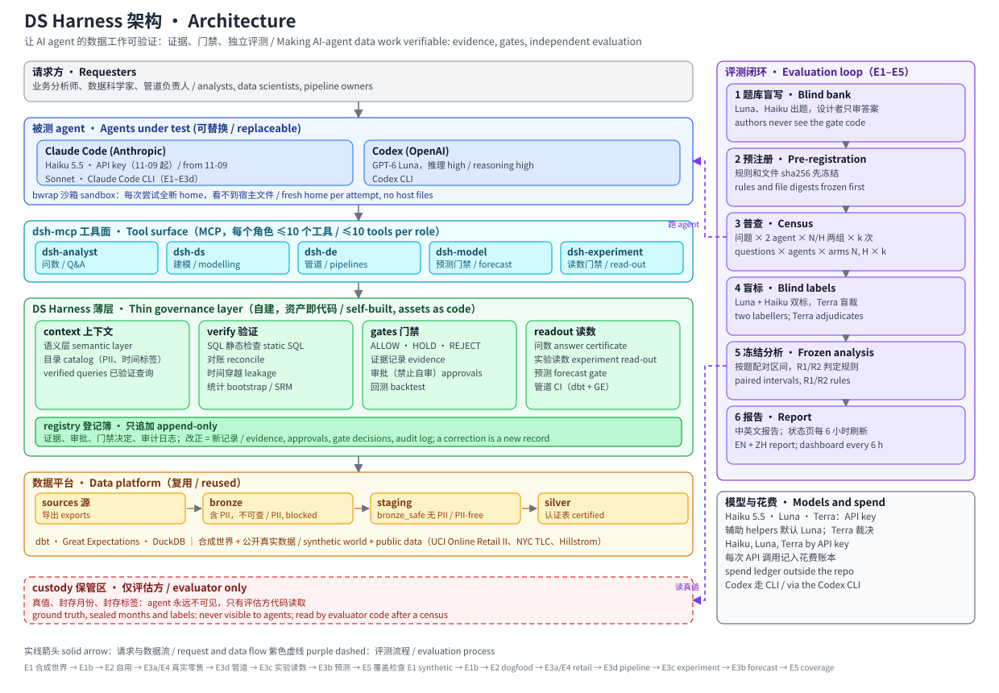

# DS Agent Harness

**DS Agent Harness is a thin governance layer between an AI coding agent and the data it works on (context, verification checks, delivery gates and an append-only evidence registry), plus a pre-registered evaluation loop that measures whether that layer actually reduces errors that look right.**

中文说明：[README.zh-CN.md](README.zh-CN.md) · Current status and results: [docs/STATUS.md](docs/STATUS.md) ([中文](docs/STATUS.zh-CN.md))

## The problem

AI agents such as Claude Code and Codex can already query a warehouse, fix a dbt pipeline or read out an A/B test. The dangerous failure is not the error that crashes. It is the *silent* error: a plausible number, effect or "fixed" pipeline that is wrong and is delivered as if it were right (a refund left in revenue, a pooled effect where two e-mails differ, a month served with 8% of its trips missing).

DS Agent Harness asks two questions:

1. Can a delivery layer catch those errors with programs (reconciliation against governed metrics, leakage checks, contract and regression checks, typed claims) and hold or reject the deliverable instead of shipping it?
2. Does it help *real* agents on *real* data, measured honestly, or does it only look good on scripted ones?

This repository is the reference implementation and the measuring instrument. It is not a production platform.

## Architecture



Behind the harness, the agent does not touch the data directly. It works through role-scoped tools (Python `dsharness.tools`, or three MCP servers: `dsh-analyst`, `dsh-ds`, `dsh-de`). Every deliverable is checked, recorded as evidence and passed through a gate that returns ALLOW, HOLD or REJECT. Ground truth lives in a custody zone that only evaluator code can read.

```
src/dsharness/
  world/        synthetic subscription company with known truth, 9 planted defect classes and a randomised retention program
  lake/         source contracts (Pandera) -> bronze -> staging -> silver (dbt-style SQL, data tests, reconciliation to finance close)
  context/      semantic layer (metric definitions), catalog (PII and time semantics), verified queries
  verify/       static SQL checks, reconciliation, time-travel leakage checks, statistics (bootstrap, SRM, calibration)
  evidence/     evidence records, gates (ALLOW / HOLD / REJECT), approvals (no self-review), in-toto export
  ml/           point-in-time features, declarative training, budgeted sealed evaluation, uplift
  decision/     policies, randomised experiments, evaluator-only oracle, experiment read-outs
  monitor/      drift (PSI)
  economics/    value and cost model
  tools/        governed tool layer (per-role isolation, audit, budgets): the agent's only way to the data
  readout/      read-out gates for answers, forecasts, experiment read-outs and pipeline changes
  bench/        scripted benchmark and the sandboxed (bwrap) census runner for real Claude Code / Codex agents
  mcp_server.py MCP server (stdio), one role per server
.claude/skills/ Agent Skills: analytics-answer, churn-modeling, pipeline-breakfix, retention-uplift; AGENTS.md: repository rules for any coding agent; .mcp.json: the three servers
experiments/    pre-registered experiments: question banks, answer keys, analysis code, frozen harness patches
docs/           design (docs/DESIGN.en-US.md), interface spec, experiment reports (docs/experiments/), data sources (docs/DATA.md)
```

## Results

All numbers below are copied from [docs/STATUS.md](docs/STATUS.md) (snapshot of 2026-11-13); each experiment has a pre-registration, a deviations log and a report under [docs/experiments/](docs/experiments/). "Silent error" means a wrong deliverable delivered as trustworthy. "Held" means a correct deliverable the gate did not let through.

| experiment | task | attempts | what was measured | result |
|---|---|---|---|---|
| [E1](docs/experiments/E1/REPORT.md) | question answering, synthetic world | 540 | harness v0.1 vs none | no help: 24.8% vs 21.5% silent errors; 64 of the 67 harness-arm errors were the harness's own (answer format, derived calculations) |
| [E1b](docs/experiments/E1b/REPORT.md) | same, new questions | 846 | v0.2 vs v0.1 vs none | v0.2: **3.9% silent errors against 20.2% without**, but 28.5% of correct answers held |
| E2 | the harness on our own 22 experiment conclusions | 22 | gate decisions | 16 allowed, 4 held, 2 rejected (materials not published: they reference private projects) |
| [E3a](docs/experiments/E3a/REPORT.md) | question answering, real retail data (UCI) | 888 | v0.3 vs none | **0.0% vs 7.9% silent errors**; 26.5% false holds |
| [E4](docs/experiments/E4/REPORT.md) | same data, new questions, v0.5 | 816 | v0.5 vs none | **not met**: agents alone were already 98.3% right; gate 2.2% vs 1.7%; 9 gate-arm errors came from the gate's own hold reasons |
| [E3d](docs/experiments/E3d/REPORT.md) | pipeline repair (dbt + Great Expectations, NYC taxi) | 144 | gate vs none | pre-registered rule met (2.8% vs 25.0% wrong or premature months), **but for the wrong reason**: 14 of the 15 errors in the other arms were harmless edits to `ci/` check scripts; without them all arms are 2.8% |
| [E3c v2](docs/experiments/E3c/REPORT.md) | reading out a randomised e-mail test (Hillstrom) | 552 | read-out gate vs none | **inconclusive** (−5.6 points [−12.8, +1.7]); errors the gate can see fell 22.6% → 6.4%, errors it cannot see rose 5.1% → 15.8% |
| [E3b v2](docs/experiments/E3b/REPORT.md) | forecasting a gift wholesaler's next quarter | 336 | forecast gate vs none | **inconclusive** (−3.1 points [−12.5, +6.9]); 30–34% of attempts have errors the gate cannot see; 8 answers made worse by the gate's reasons, 12 made better |
| [E5 phase 1](docs/experiments/E5/REPORT.md) | request-coverage check, offline on 888 replies | 0 agents | model flags replies that leave a part out | **fails the rule** (23–34% false flags, 14–57% catches); advisory only |

In total about 4,100 real-agent attempts across seven censuses, all pre-registered, with blind questions written by models that had not seen the gate code, blind two-model labels, and frozen analysis code.

What the evidence says, in short (from [STATUS.md](docs/STATUS.md#what-the-evidence-says)):

- **The gate works where it has a program.** Wrong numbers, pooled effects, fished subgroups, leaked future data and unreproducible files are caught or prevented in every experiment that had such a check.
- **The largest remaining error class is outside the programs.** "An asked part left out" is about a third of attempts in E3b and E3c, and a model judge for it failed the pre-registered rule (E3c meaning check, E5).
- **The gate can cause errors.** Its hold reasons pushed agents to a wrong reading in E4 (9 cases) and rewrote right first answers into wrong ones in E3b (8 cases).
- **Agents alone are already strong on routine questions** (E4: 98.3%), so a benefit would have to show on harder or novel requests, which is where the measured effects are inconclusive.

## Install and run

You need Python 3.12 and [uv](https://docs.astral.sh/uv/). The harness, the synthetic world and the test suite run offline, with no API keys.

```bash
uv sync                      # creates .venv from uv.lock
uv run pytest -q             # the full test suite, single process
```

Try the harness on the synthetic company:

```bash
uv run dsh world             # generate source exports and custody truth into workspace/
uv run dsh build --all       # build governed snapshots (the drift and monitor builds fail by design: the billing schema changes)
uv run dsh demo              # end-to-end scenario, 1-2 minutes
uv run dsh bench             # scripted benchmark: careful vs naive scripted agents
```

To put a real agent behind the harness, run `dsh world` and `dsh build --all`, then open Claude Code (or another MCP-capable CLI) in the repository root: it finds the three MCP servers in `.mcp.json` and the skills in `.claude/skills/`. `dsh live` grades a logged-in `claude` CLI on scripted tasks and reports SKIPPED otherwise.

The real-data experiments need public datasets that are not redistributed here; see [docs/DATA.md](docs/DATA.md) and `scripts/fetch_public_data.py`. Re-running a census also needs the `claude` and `codex` CLIs, `bwrap`, the agents' Python environments and API keys ([docs/MODEL_POLICY.md](docs/MODEL_POLICY.md)), and costs real money; the published repository does not include the per-attempt run folders or agent transcripts.

## Limitations

- **Benefit not shown where it matters most.** Silent errors were clearly lower with the gate on synthetic data (E1b) and on real retail questions (E3a); the pre-registered rule was met for the wrong reason in E3d, not met in E4, and inconclusive in E3c and E3b.
- **Over-holding.** 23–28% of correct question-answering replies are held before delivery.
- **Cost and speed.** In E4 the gate arm cost 3.1× per correct delivery for Claude and 5.5× the tokens for Codex; in E3b the cost was about equal. Gate runs take about twice as long (E4 1.8×, E3b 2×).
- **Narrow evidence.** Two agent families, public data only, no local or Chinese model, no enterprise user, 40 requests per experiment, model labels with moderate agreement (κ 0.29–0.57).
- **No commercial validation.** No user, no pricing, no independent-verification pilot, no public benchmark.
- **Synthetic results show mechanisms, not real-world accuracy.** The synthetic world has planted defects with known truth; it shows that the checks work as designed, not how often real data has these problems.
- **Reference implementation only.** DuckDB stands in for a warehouse, a tiny SQL runner for dbt/SQLMesh, local JSONL for signed attestations and string identities for an IdP.
- **Snapshot.** Experiment documents are dated working records (some partly in Chinese) and are kept as they were written, apart from the path scrubbing listed in [docs/PUBLIC_RELEASE.md](docs/PUBLIC_RELEASE.md).

## Data and licence

Code and documentation: MIT, see [LICENSE](LICENSE). Datasets keep their own terms ([docs/DATA.md](docs/DATA.md)): UCI Online Retail II is CC BY 4.0; the NYC TLC files are NYC Open Data; the Hillstrom file has no licence from its author and is used for research only (only aggregate numbers appear here).

---

Built with AI coding agents; experiment design, evaluation rules and review by Gary Xiao.
