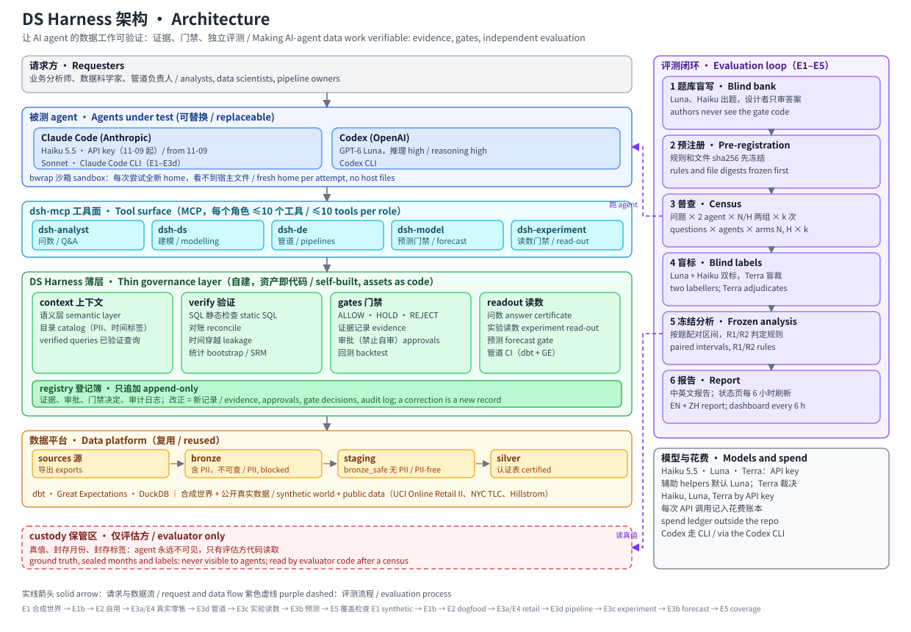

# DS Harness: summary, progress, bottlenecks, open questions (2026-11-13)

Chinese version: [STATUS.zh-CN.md](STATUS.zh-CN.md). Architecture: [architecture.svg](architecture.svg) (bilingual).
Numbers come from the experiment reports in `docs/experiments/` and the experiments' analysis outputs; each is a measured result, not
a forecast.

## What it is

A delivery layer that makes the data work of AI agents verifiable: a thin governance layer (context, verification,
gates, an append-only registry) between the agent and the data, plus an evaluation loop that tests, with
pre-registered rules and blind labels, whether the layer actually reduces errors that look right. Everything is
tested on real agents (Claude Code, Codex) in a sandbox, not only on scripted ones.

## Progress

| experiment | task | attempts | what was measured | result |
|---|---|---|---|---|
| E1 | question answering, synthetic world | 540 | harness v0.1 vs none | no help: 24.8% vs 21.5% silent errors; 64 of the 67 harness-arm errors were the harness's own (answer format, derived calculations) |
| E1b | same, new questions | 846 | v0.2 vs v0.1 vs none | v0.2: 3.9% silent errors against 20.2% without, but 28.5% of correct answers held |
| E2 | the harness on our own 22 experiment conclusions | 22 | gate decisions | 16 allowed, 4 held, 2 rejected |
| E3a | question answering, real retail data (UCI) | 888 | v0.3 vs none | 0.0% vs 7.9% silent errors; 26.5% false holds |
| E4 | same data, new questions, v0.5 | 816 | v0.5 vs none | not met: agents alone were already 98.3% right; gate 2.2% vs 1.7%; 9 gate-arm errors came from the gate's own hold reasons |
| E3d | pipeline repair (dbt + Great Expectations, NYC taxi) | 144 | gate vs none | pre-registered rule met (2.8% vs 25.0% wrong or premature months), but 14 of the 15 errors in the other arms were harmless edits to `ci/` check scripts; without them all arms are 2.8% |
| E3c v2 | reading out a randomised e-mail test (Hillstrom) | 552 | read-out gate vs none | inconclusive (−5.6 points [−12.8, +1.7]); errors the gate can see fell 22.6% → 6.4%, errors it cannot see rose 5.1% → 15.8% |
| E3b v2 | forecasting a gift wholesaler's next quarter | 336 | forecast gate vs none | inconclusive (−3.1 points [−12.5, +6.9]); 30–34% of attempts have errors the gate cannot see; 8 answers made worse by the gate's reasons, 12 made better |
| E5 phase 1 | request-coverage check, offline on 888 replies | 0 agents | model flags replies that leave a part out | fails the rule (23–34% false flags, 14–57% catches); advisory only |

In total about 4,100 real-agent attempts across seven censuses, all pre-registered with blind questions written by
models that had not seen the gate code, blind two-model labels, and frozen analysis code.

**Infrastructure built:**
- sandboxed census runner for Claude Code and Codex;
- readout gates for question answering, forecasts, experiment read-outs and pipelines;
- a model policy ([MODEL_POLICY.md](MODEL_POLICY.md)): Claude agent on Haiku 5.5 by API key, Luna helpers, Terra adjudicator,
  a spend ledger for every API call;
- code, tests and the experiments are kept in one git repository (this public copy has a fresh history).

## What the evidence says

1. **The gate works where it has a program.** Wrong numbers, pooled effects, fished subgroups, leaked future data and
   unreproducible files are caught or prevented in every experiment that had such a check.
2. **The largest remaining error class is outside the programs.** "An asked part left out" (E-read) is about a third of
   attempts in E3b and E3c and gets worse, not better, under the typed-claims workflow. A model judge for it fails the
   pre-registered rule (E3c meaning check, E5 coverage check).
3. **The gate can cause errors.** Its hold reasons pushed agents to a wrong reading in E4 (9 cases) and rewrote right
   first answers into wrong ones in E3b (8 cases).
4. **Agents alone are already strong on routine questions** (E4: 98.3%), so the benefit shows up on harder or novel
   requests, which is where our measured effects are inconclusive.

## Bottlenecks

1. **Benefit not yet shown where it matters.** Silent errors were clearly lower with the gate on synthetic data (E1b) and on
   real retail questions (E3a); the pre-registered rule was met for the wrong reason in E3d, not met in E4, and inconclusive in E3c and E3b.
2. **Over-holding.** 23–28% of correct question-answering replies are held before delivery.
3. **Cost and speed.** In E4 the gate arm cost 3.1× per correct delivery for Claude and 5.5× the tokens for Codex; in E3b the cost was about equal. It runs about twice as long (E4 1.8×, E3b 2×). A census on Haiku
   costs about $10 for the agent alone, because Haiku uses ten times the tokens of Sonnet.
4. **Narrow evidence.** Two agent families, public data only, no local or Chinese model, no enterprise user, 40
   requests per experiment, model labels with moderate agreement (κ 0.29–0.57).
5. **No commercial validation.** No user, no pricing, no independent-verification pilot, no public benchmark.
6. **Public-release hygiene.** The private repository's history contained local paths (this public copy starts a
   fresh history); the Hillstrom data has no licence (research use only; not redistributed, aggregates in reports).

## Open questions

- **Next experiment.** Candidates: an agent workflow that lists the request's parts and ticks them off in its claims;
  extending the existing quantity checks to grain, horizon and population. Either needs a new blind bank.
- **Broader agents.** Add a local or non-US model to the census.
- **Out-of-scope refusal** (target: refuse ≥ 90%): not tested; needs a new set of unanswerable questions.
- **Human-cost baseline** and onboarding time per dataset: not measured.
- **The gate's term-reading hold reason** (E4 finding): ask a human instead of making the agent redo it; needs a
  design and a new bank to test on.
- **Gate diagnostics** (E3d finding): give facts and make the agent look for the cause; needs a pipeline task that
  can really break numbers.
- **Later steps (plan steps 3–5):** an independent-verification evidence pack, a public silent-failure benchmark, standards alignment
  (not started; novelty check first).
