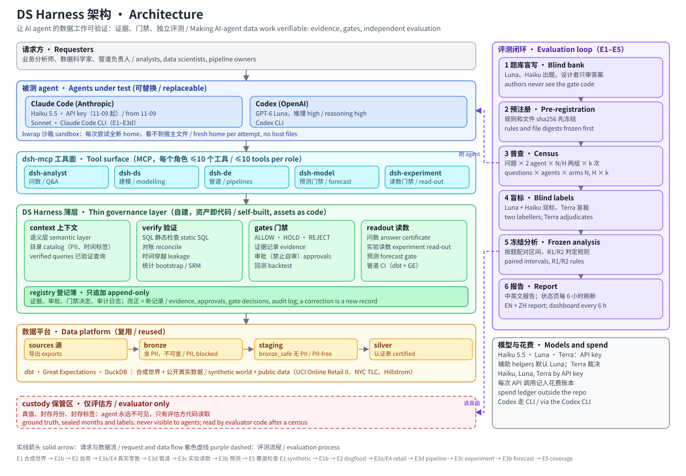

# DS Harness：总结、进展、瓶颈、待研究的问题（2026-11-13）

英文版：[STATUS.md](STATUS.md)。架构图：[architecture.svg](architecture.svg)（中英文标注）。
数字来自 `docs/experiments/` 里的实验报告和各实验的分析输出，都是实测结果，不是预测。

## 这是什么

让 AI agent 的数据工作可验证的交付层：在 agent 和数据之间放一层很薄的治理层（上下文、验证、门禁、只追加的登记簿），
再加一个评测闭环，用预注册规则和盲标签检验这一层是不是真的减少了"看起来正确"的错误。
所有检验都用真实 agent（Claude Code、Codex）在沙箱里做，不只用脚本化的 agent。

## 进展

| 实验 | 任务 | 次数 | 比较 | 结果 |
|---|---|---|---|---|
| E1 | 合成世界问数 | 540 | harness v0.1 vs 不用 | 没有帮助：静默错误 24.8% vs 21.5%；用 harness 组的 67 个错误里 64 个是 harness 自己造成的（答案格式、派生计算） |
| E1b | 同上，新题 | 846 | v0.2 vs v0.1 vs 不用 | v0.2 静默错误 3.9%，不用 20.2%，但 28.5% 的正确答案被暂缓 |
| E2 | 用门禁复查自己的 22 条实验结论 | 22 | 门禁判定 | 16 放行、4 暂缓、2 拒绝 |
| E3a | 真实零售数据（UCI）问数 | 888 | v0.3 vs 不用 | 静默错误 0.0% vs 7.9%；误拦 26.5% |
| E4 | 同一数据，新题，v0.5 | 816 | v0.5 vs 不用 | 未达标：agent 单独就已 98.3% 答对；门禁 2.2% vs 1.7%；门禁组的 9 个错误来自门禁自己的暂缓理由 |
| E3d | 管道修复（dbt + Great Expectations，纽约出租车） | 144 | 门禁 vs 不用 | 预注册规则成立（错误或过早上线的月份 2.8% vs 25.0%），但其他组 15 个错误里 14 个是对 `ci/` 检查脚本的无害改动；不算这类改动，各组都是 2.8% |
| E3c v2 | 随机邮件实验读数（Hillstrom） | 552 | 读数门禁 vs 不用 | 无定论（−5.6 个百分点 [−12.8, +1.7]）；门禁看得见的错误 22.6% → 6.4%，看不见的 5.1% → 15.8% |
| E3b v2 | 给礼品批发商预测下一季度 | 336 | 预测门禁 vs 不用 | 无定论（−3.1 个百分点 [−12.5, +6.9]）；30–34% 的尝试错在门禁看不见的地方；8 个答案被门禁的理由改坏，12 个被改好 |
| E5 第一阶段 | 请求覆盖检查，在 888 条回答上离线回放 | 无 agent | 模型标出漏答的回答 | 不合格（误标 23–34%，抓到 14–57%）；只能作提示 |

七个普查共约 4,100 次真实 agent 尝试，都做了预注册：题目由没看过门禁代码的模型盲写，两个模型盲标，分析代码事先冻结。

**已建好的基础设施：**
- 沙箱里的普查运行器，支持 Claude Code 和 Codex；
- 问数、预测、实验读数和管道四类读数门禁；
- 模型策略（[MODEL_POLICY.md](MODEL_POLICY.md)）：Claude agent 用 Haiku 5.5 加 API key，辅助模型用 Luna，Terra 裁决，
  每次 API 调用都记入花费账本；
- 代码、测试和实验都在同一个 git 仓库里（这份公开副本的历史是重新开始的）。

## 证据说明了什么

1. **有程序检查的地方，门禁有效。** 错误数字、混合效应、翻找出来的子群、泄漏的未来数据、不可复现的文件，凡是有对应检查的实验里都被抓到或阻止了。
2. **剩下最大的错误类别在程序之外。** "漏答问到的一部分"（E-read）在 E3b 和 E3c 里约占三分之一的尝试，而且在带类型声明的流程下变多。
   用模型判官去抓它没有通过预注册规则（E3c 语义检查、E5 覆盖检查）。
3. **门禁也会造成错误。** 它的暂缓理由在 E4 里把 agent 推向错误读法（9 例），在 E3b 里把原本正确的第一版答案改错（8 例）。
4. **agent 单独做常规问题已经很强**（E4：98.3%），所以收益只能出现在更难或更新的请求上，而那里我们测到的效果还没有定论。

## 瓶颈

1. **在关键场景里还没看到收益。** 门禁在合成数据（E1b）和真实零售问数（E3a）上静默错误明显更低；预注册规则在 E3d 里是因为别的原因成立，
   E4 未达标，E3c 和 E3b 无定论。
2. **误拦偏多。** 问数里 23–28% 的正确回答在交付前被暂缓。
3. **成本和速度。** E4 里门禁组每个正确交付的成本是 Claude 的 3.1 倍，Codex 的 token 是 5.5 倍；E3b 里成本大致持平。耗时约两倍（E4 为 1.8 倍，E3b 为 2 倍）。
   用 Haiku 做一次普查，光 agent 就约 10 美元，因为 Haiku 用的 token 是 Sonnet 的十倍。
4. **证据面窄。** 只有两家 agent、只用公开数据、没有本地或国内模型、没有企业用户，每个实验约 40 道请求，模型标签一致性一般（κ 0.29–0.57）。
5. **没有商业验证。** 没有用户、没有定价、没有独立验证试点、没有公开基准。
6. **公开前的清理。** 私有仓库的历史里有本机路径（这份公开副本的历史重新开始）；Hillstrom 数据没有许可证（只做研究，报告里只放汇总）。

## 待研究的问题

- **下一个实验。** 候选：让 agent 列出请求各部分并在声明里逐项对应的工作流；把现有的数量检查扩展到粒度、时间范围和人群。都需要一套新的盲题。
- **更广的 agent。** 在普查里加一个本地或非美国模型。
- **超范围拒答**（目标：拒答 ≥ 90%）：没测过，需要一套无法回答的新题。
- **人工成本基线**和每个数据集的接入耗时：没测。
- **门禁"术语读法"的暂缓理由**（E4 发现）：改成问人，不让 agent 重答；需要设计加一套新题检验。
- **门禁的诊断信息**（E3d 发现）：只给事实，让 agent 找原因；需要一个真能改坏数字的管道任务。
- **后续步骤（方案第 3–5 步）：** 独立验证证据包、公开的静默失败基准、标准对齐（没开始，先查新颖性）。
