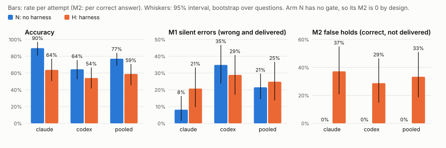
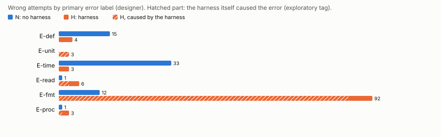
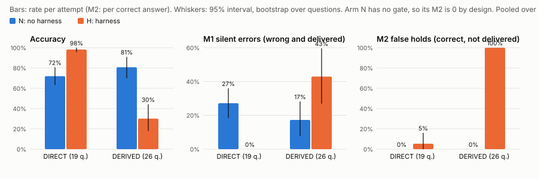

# E1 report: real-agent error census and harness A/B (pilot)

[中文摘要](REPORT.zh-CN.md)

Run 2026-11-06 on the synthetic subscription company. 540 attempts: 2 agents × 2 arms × 45 blind
questions × 3 repeats, all completed (no infrastructure retries, no process failures). The plan was
fixed in [PREREGISTRATION.md](PREREGISTRATION.md); every change after the first attempt is in
[DEVIATIONS.md](DEVIATIONS.md). Numbers come from `experiments/E1/analyze.py` and
`dsharness.bench.census.summarize`.

## Summary

1. **Pre-registered A/B: harness v0.1 did not lower silent errors.** Pooled over both agents, wrong
   answers delivered as trustworthy (M1) were 21.5% without the harness (N) and 24.8% with it (H);
   paired difference +3.3 points, 95% interval −11.5 to +18.9. The harness held 33% of correct
   answers (M2). Decision rules: D1 not met, D2 not met, D3 not met (strict reading), **D4 met:
   the harness is too strict for real use as it stands.**
2. **Why (exploratory split by question form).** On the 19 questions whose answer is one governed
   metric unchanged (DIRECT), the harness did what it was built for: **0 silent errors in 114
   attempts against 31 (27%) without it**, accuracy 98% vs 72%. On the 26 questions that need one
   more step (DERIVED: a quarter total, CNY instead of fen, a share, a difference, growth, a ranking)
   it failed: silent errors 43% vs 17%, accuracy 30% vs 81%, and **every correct derived answer was
   held** (M2 = 100%).
3. **The harness caused almost all of its own silent errors.** 64 of the 67 silent errors in arm H
   are tagged harness-induced. The gate stamped VERIFIED on the governed monthly rows (often in fen)
   when the question asked for one total in CNY, a share or a difference; the tool hint said "Report
   these rows unchanged", and a correct derived answer failed reconciliation. In 95 of the 111 wrong
   H attempts the agent had computed the right value somewhere in its work.
4. **What agents get wrong on their own is not what the planted defects anticipated.** Without the
   harness, Claude Code was wrong on 14 of 135 attempts; Codex on 48, of which 33 are one
   month-boundary error (counting subscriptions that start at 00:00 on the 1st as active at the
   start of the month). No attempt in either arm was labelled with the labels for the planted
   warehouse defects (test accounts, refunds, duplicates, staging source, late data, join fan-out,
   aggregation).

The fix list for H v0.2 was frozen from these failures before any new question was written:
[H_v0.2_PLAN.md](../H_v0.2_PLAN.md). It is tested on new blind questions in E1b; E1 stays as it is.

## Setup

- Agents: Claude Code 2.1.296 with Sonnet 5.5 (`claude`); Codex CLI 0.162 with gpt-6-luna, high
  reasoning effort (`codex`). Each attempt runs in a fresh bubblewrap sandbox with no repository,
  no memories and no web.
- **Arm N:** a copy of the warehouse and a data catalog with the official metric definitions,
  Python with duckdb. Delivered = the agent says it succeeded.
- **Arm H:** only the harness's 7 analyst tools. Delivered = the answer equals a `submit_answer`
  that returned VERIFIED / ALLOW.
- Questions: 45 = 6 designer questions + 39 written by two outside models (Luna, Haiku) that saw
  only a business brief and wrote the truth SQL ([author_brief.md](author_brief.md)).
- Grading: pre-registered rule (keys exact; value within 0.05% or half a unit of the last reported
  decimal, with at least 3 significant digits; share ↔ percent accepted, fen ↔ CNY not).

## Pre-registered results

| agent / arm | accuracy | M1 silent errors | M2 false holds | abstained | M4 pass^3 | M3 cost per correct delivered | median time |
|---|---|---|---|---|---|---|---|
| claude / N | 89.6% [80.7, 97.0] | 8.1% [1.5, 16.3] | 0% | 2.2% | 0.87 | $0.037 | 10 s |
| claude / H | 63.7% [50.4, 77.0] | 20.7% [9.6, 33.3] | 37.2% [20.8, 55.0] | 43.0% | 0.60 | $0.111 | 18 s |
| codex / N | 64.4% [52.6, 75.6] | 34.8% [23.7, 46.7] | 0% | 0.7% | 0.51 | 244 k tokens | 38 s |
| codex / H | 54.1% [41.5, 66.7] | 28.9% [17.0, 40.7] | 28.8% [14.8, 46.5] | 33.3% | 0.40 | 1,146 k tokens | 38 s |
| **pooled / N** | 77.0% [68.9, 84.1] | **21.5%** [14.4, 29.6] | 0% | 1.5% | 0.69 | — | 18 s |
| **pooled / H** | 58.9% [45.6, 70.7] | **24.8%** [13.7, 36.7] | **33.3%** [18.6, 51.0] | 38.1% | 0.50 | — | 25 s |

270 attempts per pooled row, 135 per agent row. Brackets: 95% intervals, bootstrap over the 45
questions (2,000 resamples). M3 is USD for Claude (API-equivalent) and tokens for Codex
(subscription), so it is not pooled. Arm N has no gate, so its M2 is 0 by construction.

Paired difference M1(H) − M1(N), bootstrap over questions: claude +12.6 points [0.0, +25.2],
codex −5.9 [−25.2, +14.8], pooled +3.3 [−11.5, +18.9].

### Decision rules

| rule | condition | value | met? | consequence |
|---|---|---|---|---|
| D1 | pooled M1(H) ≤ 0.8 × M1(N), CI of the difference below 0, M2(H) ≤ 15% | 24.8% vs 21.5% (ratio 1.16); CI [−11.5, +18.9]; M2 33% | **no** | the harness is not yet a product |
| D2 | M1(N) < 2% | 21.5% | **no** | agents with good documentation are often wrong and confident; the gate is worth building |
| D3 | > 50% of N's wrong attempts in labels no check covers | 8% strict ("no"); 82% if "partly" counts as uncovered | **no** (strict) | see below |
| D4 | M2(H) > 15% | 33.3% | **yes** | fix coverage before claiming value: governed paths for derived questions |

D3 depends on how the "partly covered" labels are read. 33 of N's 62 wrong attempts are E-time,
which [coverage.md](../../../experiments/E1/coverage.md) marks "partly" (the gate parses months
from the question, not the agent's own boundary logic). But the E-time errors here are the agent's
own month-boundary SQL, which a governed metric does not reproduce: on DIRECT questions arm H had
none of them. Under the pre-registered strict reading D3 is not met.

## Error labels

The designer labelled all 173 wrong attempts with one primary label
([LABEL_GUIDE.md](../../../experiments/E1/LABEL_GUIDE.md)); Haiku 5.5 labelled a random 30% (52)
blind. Agreement 73%, **Cohen's κ = 0.58** (moderate). Most disagreements are the designer's E-def
read by Haiku as E-late or E-read (agents rebuilding "status as known then").

| label | N: claude | N: codex | H: claude | H: codex | H: caused by the harness |
|---|---|---|---|---|---|
| E-fmt answer shape | 9 | 3 | 42 | 50 | 85 |
| E-time period / boundary | 0 | 33 | 0 | 3 | 0 |
| E-def definition | 4 | 11 | 1 | 3 | 0 |
| E-read misread question | 1 | 0 | 3 | 3 | 3 |
| E-unit fen / CNY | 0 | 0 | 3 | 0 | 3 |
| E-proc process | 0 | 1 | 0 | 3 | 1 |
| E-test, E-refund, E-dup, E-late, E-src, E-join, E-calc, E-other | 0 | 0 | 0 | 0 | 0 |
| **wrong attempts** | **14** | **48** | **49** | **62** | **92** |

What the labels say:

- **Arm H failed on shape, not on substance.** 92 of 111 wrong H attempts are E-fmt, and 85 of
  those were caused by the harness: the agent had the quarter total, the share or the difference,
  submitted it, saw it FLAGGED (it does not equal the metric's rows), and fell back to the governed
  monthly rows, which the gate then VERIFIED. Smaller harness causes: "first quarter of 2026"
  parsed as all of 2026; "including add-ons and refunds" read as a request for a breakdown by
  invoice type; the Chinese region name 北区 not recognised; a worked example copied for the wrong
  slice.
- **Arm N failed on definitions and boundaries.** Codex counted subscriptions starting at exactly
  00:00 on the 1st as active at the start of that month (33 attempts; in 10 it had first printed
  the right value), or rebuilt "status as known then" instead of the official definition (11).
  Claude's few errors are mostly answer format.
- No attempt was labelled E-test, E-refund, E-dup, E-src, E-late, E-join or E-calc, the labels of
  the planted warehouse defects: with a good catalog, both agents avoided them. (Haiku labelled 3 of
  the designer's E-def attempts E-late, so "late data" is not entirely absent.)

## Exploratory: DIRECT vs DERIVED questions

The split was made blind by Haiku from the questions and the metric list only (19 DIRECT, 26
DERIVED; see DEVIATIONS). The designer decided to report it after seeing early results, so it is
exploratory and does not enter the decision rules.

| form | arm | attempts | accuracy | M1 silent errors | M2 false holds |
|---|---|---|---|---|---|
| DIRECT | N | 114 | 71.9% [63.2, 80.7] | 27.2% [18.4, 36.0] | 0% |
| DIRECT | H | 114 | **98.2%** [95.6, 100] | **0.0%** [0, 0] | 5.4% [0, 16.1] |
| DERIVED | N | 156 | 80.8% [69.9, 91.0] | 17.3% [7.7, 28.2] | 0% |
| DERIVED | H | 156 | 30.1% [17.9, 44.2] | 42.9% [26.9, 59.6] | **100%** |

## Sensitivity: answers the grader cannot read

16 wrong attempts (6 N, 10 H) carry the right value in a form the pre-registered grader rejects:
0.200 arrives as the JSON number 0.2 (one significant digit), or a row is keyed with a period such
as `2026-Q1` or `2025 average` that fails the month check. Counted as correct, pooled M1 becomes
19.3% (N) and 24.8% (H), M2(H) 37.3%. No decision rule changes. The grader stays as registered for
E1; E1b's pre-registration will say how values with trailing zeros and period keys are read.

## What changes next

- **H v0.2** ([plan](../H_v0.2_PLAN.md)): an answer-shape check (one value vs one row per month,
  CNY vs fen); declared derivations that the harness recomputes from governed rows (sum, mean,
  pooled rate, growth, share, difference, ratio, top-N, keep, unit); Chinese month scopes and
  dimension aliases; period keys; tool hints that stop saying "report these rows unchanged".
  Each fix has a regression test built from an E1 failure.
- **E1b**: H v0.2 against N and H v0.1 on new blind questions from the same brief, same metrics and
  decision rules.
- **Checks for what agents actually get wrong** (D3 discussion): start-of-month boundaries and
  "as known then" reconstructions. A governed metric already prevents them; for answers that do not
  go through one, a boundary probe (recompute with `<` vs `<=` at the month edge) is a candidate.

## Limits

- 45 questions, 2 agents, one synthetic world written by the designer; the pilot can detect only
  large effects (pre-registration, "Pilot caveat").
- The coverage map, the label guide and the DIRECT/DERIVED split come from the designer side; κ
  0.58 is moderate. Labels from five designer-briefed subagents follow one written guide.
- The harness tested is v0.1. These results say nothing yet about v0.2.
- M3 is not comparable across agents (USD vs tokens).
