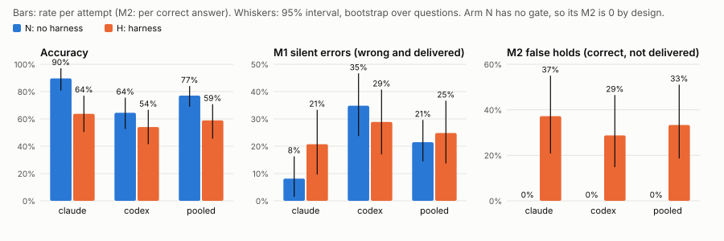
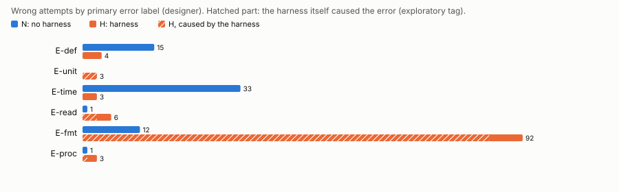
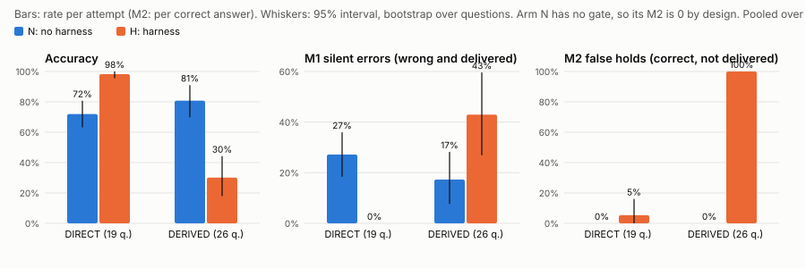

# E1 报告（中文摘要）：真实 agent 错误普查与 harness A/B（试点）

英文全文见 [REPORT.md](REPORT.md)，数字以英文版为准。2026-11-06 在合成订阅公司数据上运行，共 540 次尝试：
2 个 agent × 2 组 × 45 道盲题 × 每题 3 次，全部完成，没有基础设施重试。方案事先登记在
[PREREGISTRATION.md](PREREGISTRATION.md)，首次尝试之后的所有改动记在 [DEVIATIONS.md](DEVIATIONS.md)。

## 结论

1. **预注册的 A/B：harness v0.1 没有降低静默错误。** 两个 agent 合计，答错却被当作可信结果交付的比例（M1）：
   不用 harness（N 组）21.5%，用 harness（H 组）24.8%；配对差 +3.3 个百分点，95% 区间 −11.5 到 +18.9。
   harness 暂缓了 33% 的正确答案（M2，误拦率）。判定：D1 未达成，D2 未达成，D3 未达成（严格口径），
   **D4 达成：harness 现在太严，还不能实际使用。**
2. **原因（探索性分析，按题型拆分）。** 19 道"直接题"的答案就是一个治理指标的原样结果。在这类题上 harness 达到了设计目标：
   **114 次尝试 0 次静默错误，N 组是 31 次（27%）**，正确率 98% 对 72%。另外 26 道"派生题"还要多算一步
   （季度合计、分换算成元、占比、差值、增长率、排名）。在这类题上 harness 失败了：静默错误 43% 对 17%，正确率 30% 对 81%，
   **所有算对的派生答案都被暂缓**（M2 = 100%）。
3. **H 组的静默错误几乎都是 harness 自己造成的。** H 组 67 次静默错误中 64 次标为"harness 造成"。题目要的是一个人民币合计、
   一个占比或一个差值，agent 提交的却是按月、以分为单位的治理指标原始行，门禁仍然给了 VERIFIED。工具提示写着
   "Report these rows unchanged"（原样报告这些行）；算对的派生答案又过不了核对。H 组 111 次答错里，有 95 次 agent
   在过程中其实算出过正确值。
4. **agent 自己犯的错，和事先埋的缺陷不是一回事。** 没有 harness 时，Claude Code 135 次尝试中答错 14 次，Codex 答错 48 次，
   其中 33 次是同一个月界错误：把月初 00:00 开始的订阅算成"月初活跃"。两组都没有一次错误落在埋好的仓库缺陷标签上
  （测试账号、退款、重复行、staging 源、迟到数据、连接扇出、聚合）。

H v0.2 的修复清单是根据这些失败定的，并且在写任何新题之前就冻结了：[H_v0.2_PLAN.md](../H_v0.2_PLAN.md)。
v0.2 在 E1b 中用新的盲题检验；E1 本身保持不变。

## 预注册结果

| agent / 组 | 正确率 | M1 静默错误 | M2 误拦 | 弃答 | M4 连续 3 次全对 | M3 每个正确交付的成本 | 中位耗时 |
|---|---|---|---|---|---|---|---|
| claude / N | 89.6% | 8.1% | 0% | 2.2% | 0.87 | $0.037 | 10 s |
| claude / H | 63.7% | 20.7% | 37.2% | 43.0% | 0.60 | $0.111 | 18 s |
| codex / N | 64.4% | 34.8% | 0% | 0.7% | 0.51 | 244 k tokens | 38 s |
| codex / H | 54.1% | 28.9% | 28.8% | 33.3% | 0.40 | 1,146 k tokens | 38 s |
| **合计 / N** | 77.0% | **21.5%** [14.4, 29.6] | 0% | 1.5% | 0.69 | — | 18 s |
| **合计 / H** | 58.9% | **24.8%** [13.7, 36.7] | **33.3%** [18.6, 51.0] | 38.1% | 0.50 | — | 25 s |

方括号是 95% 区间，对 45 道题做 2,000 次自助抽样。N 组没有门禁，M2 按定义为 0。M3 中 Claude 用美元（按 API 价折算），
Codex 用 token（订阅制），两者不能合并。

| 规则 | 条件 | 数值 | 是否达成 | 含义 |
|---|---|---|---|---|
| D1 | 合计 M1(H) ≤ 0.8 × M1(N)，差值区间整体低于 0，M2(H) ≤ 15% | 24.8% 对 21.5%；区间 [−11.5, +18.9]；M2 33% | **否** | harness 还不是产品 |
| D2 | M1(N) < 2% | 21.5% | **否** | 文档写得好，agent 照样经常自信地答错，门禁值得做 |
| D3 | N 组错误中超过一半落在没有检查覆盖的标签上 | 严格口径 8%；把"部分覆盖"算作未覆盖则 82% | **否**（严格口径） | 见英文版讨论 |
| D4 | M2(H) > 15% | 33.3% | **是** | 先补派生题的治理路径，再谈价值 |

## 错误标签

设计者给全部 173 次错误尝试各打一个主标签（[LABEL_GUIDE.md](../../../experiments/E1/LABEL_GUIDE.md)）。Haiku 5.5
盲标其中随机 30%（52 次），一致率 73%，**Cohen's κ = 0.58**（中等）。

| 标签 | N: claude | N: codex | H: claude | H: codex | H 中由 harness 造成 |
|---|---|---|---|---|---|
| E-fmt 答案形状 | 9 | 3 | 42 | 50 | 85 |
| E-time 期间 / 月界 | 0 | 33 | 0 | 3 | 0 |
| E-def 定义 | 4 | 11 | 1 | 3 | 0 |
| E-read 读错题 | 1 | 0 | 3 | 3 | 3 |
| E-unit 分 / 元 | 0 | 0 | 3 | 0 | 3 |
| E-proc 流程 | 0 | 1 | 0 | 3 | 1 |
| 其余缺陷标签 | 0 | 0 | 0 | 0 | 0 |
| **错误尝试合计** | **14** | **48** | **49** | **62** | **92** |

## 探索性：直接题与派生题

题型由 Haiku 只看题目和指标清单盲分（19 道直接题，26 道派生题）。这个拆分是看到早期结果之后才决定报告的，
属于探索性分析，不进入判定规则。（E1b 已把它预注册为次要分析。）

| 题型 | 组 | 尝试 | 正确率 | M1 静默错误 | M2 误拦 |
|---|---|---|---|---|---|
| 直接题 | N | 114 | 71.9% | 27.2% | 0% |
| 直接题 | H | 114 | **98.2%** | **0.0%** | 5.4% |
| 派生题 | N | 156 | 80.8% | 17.3% | 0% |
| 派生题 | H | 156 | 30.1% | 42.9% | **100%** |

## 敏感性：评分器读不出的正确答案

有 16 次错误尝试（N 组 6 次，H 组 10 次）值其实是对的，但预注册的评分器不认它的形式：0.200 以 JSON 数字 0.2 送达，
只剩一位有效数字；或者某一行的键是 `2026-Q1`、`2025 average` 这类期间，过不了月份检查。把它们算作正确，
合计 M1 变为 19.3%（N）和 24.8%（H），M2(H) 变为 37.3%。判定结果不变。

## 局限

- 只有 45 道题、2 个 agent、一个设计者写的合成世界；试点只能发现很大的效应。
- 覆盖表、标签指南和题型拆分都来自设计者一方；κ 0.58 属于中等。
- 测的是 harness v0.1，这些结果不说明 v0.2 的好坏。
