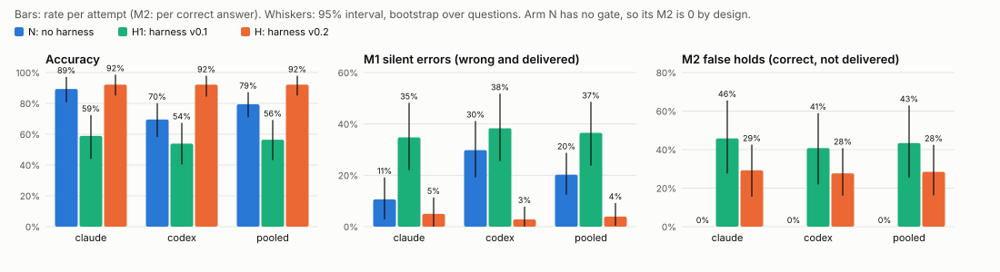
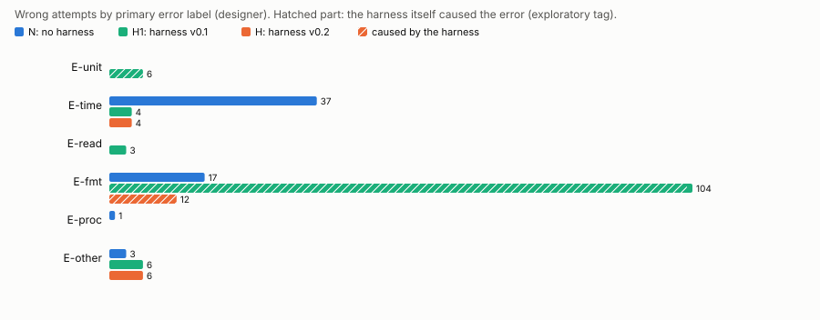
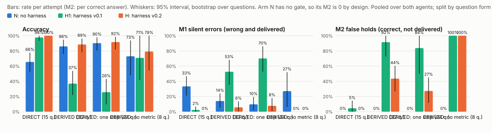

# E1b report: harness v0.2 on new blind questions

[中文摘要](REPORT.zh-CN.md)

Run 2026-11-06 22:46 to 2026-11-07 about 02:20 (CST) on the same synthetic subscription company as E1.
846 attempts: 2 agents × 3 arms × 47 new blind questions × 3 repeats, all completed (no
infrastructure retries). The plan was fixed in [PREREGISTRATION.md](PREREGISTRATION.md) before the
first attempt; changes and clarifications are in [DEVIATIONS.md](DEVIATIONS.md). Numbers come from
`experiments/E1/analyze.py`; the exploratory tables come from `experiments/E1b/hold_reasons.py` and
`experiments/E1b/delivery_match.py`.

## Summary

1. **Silent errors fell to a fifth of the no-harness rate, but the harness still holds too many
   correct answers.** Pooled over both agents, wrong answers delivered as trustworthy (M1) were
   20.2% without the harness (N), **3.9% with harness v0.2 (H)** and 36.5% with v0.1 (H1). Paired
   difference H − N −16.3 points, 95% interval −25.2 to −7.1 (ratio 0.19). But H held 28.5% of its
   correct answers (M2). Decision rules: **D1 not met** (only its M2 condition fails), **D4 met**:
   still too strict for a value claim. **D5 met**: the v0.2 fixes worked out of sample (M1 −32.6
   points against v0.1, interval −45.4 to −20.6; M2 28.5% vs 43.4%). **D6 not met**: on DIRECT
   questions v0.2 delivered no wrong answer (0 of 90).
2. **Every silent error in arm H was caused by the harness, and the planned v0.3 fixes cover all
   11.** In all 11 the agent had the right value (a region's share, the highest month, one month
   minus another), the v0.2 derive step refused to verify that single value, and the agent fell back
   to rows the gate did verify (all regions' shares, all twelve months). Fixes F15 and F16 in
   [H_v0.3_PLAN.md](../H_v0.3_PLAN.md) close both gaps, each with a regression test built from these
   attempts. The 10 wrong answers the harness did not cause were all held.
3. **Most false holds are answers outside the governed metrics.** Of the 74 correct answers H held,
   56 answer questions that no governed metric covers (sign-ups, tickets, watch minutes, plan price,
   distinct churners over a year); the harness can only hold them. 7 were verified and then retyped
   in the final answer (611761 sent, 611761.0 reported), which the census counts as not delivered;
   10 hit two derive gaps (running total, month minus month). Even with all of those fixed, M2(H)
   would be about 22%: **coverage, not the gate's logic, is what keeps D1 out of reach.**
4. **Agents' own errors are the same as in E1.** Without the harness, Codex delivered 37 wrong
   answers with the start-of-month boundary error (subscriptions that start at 00:00 on the 1st
   counted as active at the start of that month), on 18 of 47 questions; in 12 it had printed the
   right value first. Claude Code's wrong answers were format (12) and one ambiguous question (3).
   With the harness, the governed metrics removed the boundary error on every question they cover:
   accuracy 92.2% (H) vs 79.4% (N).

## Setup

As in E1 ([report](../E1/REPORT.md)): Claude Code 2.1.296 with Sonnet 5.5 (`claude`), Codex CLI
0.162.0-alpha.17.2 with gpt-6-luna at high effort (`codex`), each attempt in a fresh bubblewrap
sandbox with no repository, no memories and no web.

| arm | what the agent has | delivered means |
|---|---|---|
| N | warehouse copy + the E1 data catalog + Python with duckdb | the agent says it succeeded |
| H1 | harness v0.1, served from a frozen snapshot (58 files, SHA256SUMS re-checked after the run) | the final answer equals a `submit_answer` that returned VERIFIED / ALLOW |
| H | harness v0.2 (six file digests in [H_v0.2_PLAN.md](../H_v0.2_PLAN.md), re-checked after the run) | same as H1 |

Questions: 47 new blind questions from the E1 brief and the same two outside authors (Luna 18,
Haiku 29; 39 English, 8 Chinese); 25 rewordings of E1 or earlier E1b items were dropped by a
mechanical rule. Blind classification before any attempt: 15 DIRECT (one governed metric
unchanged), 32 DERIVED, of which 24 are one step on a governed metric and 8 have no governed metric.
Grading as in E1 (keys exact; value within 0.05% or half a unit of the last reported decimal, at
least 3 significant digits; share ↔ percent accepted, fen ↔ CNY not).

## Pre-registered results

| agent / arm | accuracy | M1 silent errors | M2 false holds | abstained | M4 pass^3 | M3 cost per correct delivered | median time |
|---|---|---|---|---|---|---|---|
| claude / N | 89.4% [80.9, 97.2] | 10.6% [2.8, 19.1] | 0% | 0.0% | 0.87 | $0.047 | 9 s |
| claude / H1 | 58.9% [44.0, 72.3] | 34.8% [22.0, 48.2] | 45.8% [27.6, 65.5] | 33.3% | 0.57 | $0.165 | 16 s |
| claude / H | 92.2% [85.1, 98.6] | 5.0% [0.0, 11.3] | 29.2% [15.6, 42.5] | 27.7% | 0.89 | $0.075 | 15 s |
| codex / N | 69.5% [58.2, 80.1] | 29.8% [19.1, 41.1] | 0% | 0.7% | 0.57 | 225 k tokens | 41 s |
| codex / H1 | 53.9% [40.4, 67.4] | 38.3% [25.5, 51.8] | 40.8% [21.9, 58.9] | 29.8% | 0.51 | 1,199 k tokens | 46 s |
| codex / H | 92.2% [84.4, 97.9] | 2.8% [0.0, 7.8] | 27.7% [16.0, 40.7] | 27.0% | 0.89 | 573 k tokens | 37 s |
| **pooled / N** | 79.4% [70.9, 87.2] | **20.2%** [12.4, 28.7] | 0% | 0.4% | 0.72 | — | 19 s |
| **pooled / H1** | 56.4% [43.3, 69.1] | **36.5%** [23.8, 48.6] | 43.4% [25.5, 62.9] | 31.6% | 0.54 | — | 26 s |
| **pooled / H** | 92.2% [85.1, 97.9] | **3.9%** [0.4, 9.2] | **28.5%** [16.3, 42.4] | 27.3% | 0.89 | — | 24 s |

282 attempts per pooled row, 141 per agent row. Brackets: 95% intervals, bootstrap over the 47
questions (2,000 resamples). M3 is USD for Claude (API-equivalent) and tokens for Codex
(subscription), so it is not pooled. Arm N has no gate, so its M2 is 0 by construction.

Paired differences in M1, bootstrap over questions:

| comparison | claude | codex | pooled |
|---|---|---|---|
| H − N | −5.7 [−16.3, +4.3] | −27.0 [−38.3, −15.6] | **−16.3 [−25.2, −7.1]** |
| H − H1 | −29.8 [−43.3, −17.0] | −35.5 [−48.9, −22.7] | **−32.6 [−45.4, −20.6]** |
| H1 − N | +24.1 [+8.5, +39.7] | +8.5 [−12.1, +29.8] | +16.3 [−0.4, +33.3] |

### Decision rules

| rule | condition | value | met? | consequence |
|---|---|---|---|---|
| D1 | pooled M1(H) ≤ 0.8 × M1(N), upper end of the interval of H − N below 0, and M2(H) ≤ 15% | 3.9% vs 20.2% (ratio 0.19); interval [−25.2, −7.1]; **M2 28.5%** | **no** | not yet a product claim |
| D4 | M2(H) > 15% | 28.5% | **yes** | still too strict: more coverage before any value claim |
| D5 | upper end of the interval of M1(H) − M1(H1) below 0, and M2(H) < M2(H1) | −32.6 [−45.4, −20.6]; 28.5% < 43.4% | **yes** | the v0.2 fixes worked out of sample |
| D6 | on DIRECT questions, M1(H) > M1(H1) + 5 points | 0.0% vs 2.2% | **no** | the fixes did not break what worked |

Two of D1's three conditions are met with room to spare; the false-hold rate alone fails it. The
pre-registration says an inconclusive result leads to more questions, not to a reinterpretation, so
D1 stands as not met. The sections below say where the holds come from.

## Error labels

The designer labelled all 203 wrong attempts with one primary label
([LABEL_GUIDE.md](../../../experiments/E1/LABEL_GUIDE.md); labelling rules settled on the first 120
sheets are in DEVIATIONS); Haiku 5.5 labelled a random 30% (61) blind. Agreement 75%, **Cohen's
κ = 0.62** (substantial; E1 0.58). 6 of the 15 disagreements are question C-H11 (below), which
Haiku read as test accounts or a definition error; 7 are the designer's E-time read as E-src, E-def,
E-late, E-calc or E-fmt.

| label | N: claude | N: codex | H1: claude | H1: codex | H: claude | H: codex |
|---|---|---|---|---|---|---|
| E-fmt answer shape | 12 | 5 | 49 | 55 | 8 | 4 |
| E-time period / boundary | 0 | 37 | 0 | 4 | 0 | 4 |
| E-unit fen / CNY | 0 | 0 | 3 | 3 | 0 | 0 |
| E-read misread question | 0 | 0 | 3 | 0 | 0 | 0 |
| E-proc process | 0 | 1 | 0 | 0 | 0 | 0 |
| E-other (C-H11) | 3 | 0 | 3 | 3 | 3 | 3 |
| **wrong attempts** | **15** | **43** | **58** | **65** | **11** | **11** |
| of which caused by the harness | — | — | 52 | 57 | 8 | 4 |
| of which delivered (silent errors) | 15 | 42 | 49 | 54 | 7 | 4 |

What the labels say:

- **Arm H: 11 silent errors, all harness-induced, two causes.** (a) *A share of one named group*
  (C-H15, C-L28; 4 attempts): the agent submitted the west region's share with `derive.across.op =
  share`, and v0.2 answered that the derived rows are every region, so the agent submitted all four
  shares, which verified. (b) *An operation across months* (C-H20, C-H31; 7 attempts): "which
  month had the highest churn rate" and "February 2026 minus February 2025" need `across` over the
  month column, which v0.2 refused ("month must be one of metric_call.dimensions"), so agents
  submitted the twelve monthly rates. In every one of the 11, the agent's notes show the right
  single value.
- **Arm H held every wrong answer it did not cause.** The 4 E-time attempts (Codex's own boundary
  SQL on C-H33 and C-H34, questions with no governed path) and the 6 C-H11 attempts were all held.
- **Arm H1 repeats E1.** 109 of its 123 wrong attempts are harness-induced (E-fmt and E-unit:
  monthly fen rows verified where one CNY total, a share or a difference was asked), and in 109 the
  agent had the right value. With more DERIVED questions than E1 (32 of 47 vs 26 of 45), v0.1 is
  worse than no harness on silent errors (+16.3 points, interval −0.4 to +33.3).
- **Arm N: Codex's boundary error again.** 37 of Codex's 43 wrong attempts are E-time, spread over
  18 questions; in 12 it had first printed the right value. 9 of the 17 E-fmt attempts in arm N are
  exact values the grader cannot read (below).
- As in E1, no attempt in any arm was labelled with the planted warehouse defects (test accounts,
  refunds, duplicates, staging source, late data, join fan-out, aggregation).

## Secondary analysis (pre-registered): DIRECT vs DERIVED

| form | arm | attempts | accuracy | M1 silent errors | M2 false holds |
|---|---|---|---|---|---|
| DIRECT | N | 90 | 65.6% [52.2, 77.8] | 33.3% [21.1, 46.7] | 0% |
| DIRECT | H1 | 90 | 97.8% [93.3, 100] | 2.2% [0, 6.7] | 4.5% [0, 14.3] |
| DIRECT | H | 90 | **100%** | **0.0%** | **0.0%** |
| DERIVED | N | 192 | 85.9% [76.0, 94.8] | 14.1% [5.2, 24.0] | 0% |
| DERIVED | H1 | 192 | 37.0% [21.9, 53.6] | 52.6% [35.4, 68.2] | 91.5% [72.7, 100] |
| DERIVED | H | 192 | 88.5% [78.1, 96.4] | 5.7% [0.5, 13.5] | 43.5% [26.6, 60.4] |

Descriptive split of the DERIVED questions, fixed in the pre-registration:

| DERIVED form | arm | attempts | accuracy | M1 | M2 |
|---|---|---|---|---|---|
| one step on a governed metric (24 questions) | N | 144 | 90.3% | 9.7% | 0% |
| | H1 | 144 | 25.7% | 70.1% | 83.8% |
| | H | 144 | 91.7% | 7.6% | 27.3% |
| no governed metric (8 questions) | N | 48 | 72.9% | 27.1% | 0% |
| | H1 | 48 | 70.8% | 0.0% | 100% |
| | H | 48 | 79.2% | 0.0% | **100%** |

v0.2 kept v0.1's DIRECT result (no silent error) and turned DERIVED from v0.1's worst case (M1
52.6%) into the same range as DIRECT for silent errors. On the 8 no-metric questions both harness
versions hold every correct answer, as the pre-registration expected.

## Exploratory: why arm H held 74 correct answers

From each held attempt's last answer certificate and the census record (all rows:
[hold_reasons.md](hold_reasons.md)). The grouping by cause is the designer's.

| cause | questions | attempts | what would change it |
|---|---|---|---|
| no governed metric covers the answer (the 8 pre-registered no-metric questions) | 8 | 38 | coverage, not the gate |
| "average monthly plan price": classified as one step on ARPU, but the catalog has no plan-price metric | C-H13, C-L11 | 12 | coverage |
| distinct subscribers who churned over a whole year: monthly churn counts cannot be summed into a distinct count, so agents used their own SQL | C-H14 | 6 | coverage |
| verified, then the final answer retyped a number (611761 → 611761.0; a 17th digit dropped), so the census found no submission with those rows | C-H28, C-H12, C-L34 | 7 | census: compare rows as numbers (v0.3 S2) |
| running total per month: derive had no running total; one agent tried `months: cumsum` and was refused | C-H32 | 6 | F17 (v0.3) |
| one month minus another: across months refused | C-H31 | 4 | F16 (v0.3) |
| other (no reason recorded) | C-L14 | 1 | — |
| **total** | | **74** | |

Counted as delivered, the 7 retyped answers bring M2(H) from 28.5% to 25.8%; if the 10 derive-gap
attempts had also verified, it would be 21.9%. The remaining 56 holds (21.5% of H's correct answers)
are questions outside the governed metrics. **D1's 15% bar cannot be reached on a bank where 11 of
47 questions have no governed path, unless the harness gets a way to deliver answers it cannot
reconcile with a governed metric.** These counts are exploratory and are not a reinterpretation of
D1. They assume the agents would use the new steps, which E3a tests.

## Sensitivity analyses

None of these changes a decision rule.

| analysis | attempts affected | M1 N / H1 / H | M2 H1 / H |
|---|---|---|---|
| as registered | — | 20.2% / 36.5% / 3.9% | 43.4% / 28.5% |
| grader: exact values the grader rejects counted as correct | 10 (9 N, 1 H1) | 17.0% / 36.5% / 3.9% | 43.8% / 28.5% |
| question: C-H11 left out | 18 (all wrong, every arm) | 18.5% / 37.3% / 4.0% | 43.4% / 28.5% |
| census: final rows matched to a submission as numbers | 7 H, 6 H1 | 20.2% / 36.5% / 3.9% | 43.4% / 25.8% |

- **Grader.** The 10 are: 0.0580, 0.0470 or −1.00 written in the final JSON but parsed as the numbers
  0.058, 0.047 and −1.0, too few significant digits (5); the plan names written in Chinese, where
  the grader maps 基础版 and 专业版 but not "Plus版" (4); full-year rows keyed "2025" (1). The grader
  stays as registered.
- **Question C-H11** asks for "total support tickets per subscriber" in February 2026. Its truth
  counts only tickets opened by subscribers active on 1 February (682 / 3,497 = 0.1950); every agent
  in every arm counted all non-test tickets (730 / 3,497 = 0.2088), which the wording supports. The
  answers are labelled E-other with a "question?" note; the question stays in the bank.
- **Census matching** (`delivery_match.py`): of the 13 arm-H correct attempts whose final rows match
  no submission byte for byte, 7 match a VERIFIED / ALLOW submission as numbers (12 significant
  digits); the other 6 match only held submissions. H1: 6, none verified. E1 had none.
- **Disclosure: arm N could not query the raw export.** The warehouse copy for arm N kept the
  `bronze_safe` views but not the `bronze` schema they read from (as in E1; see DEVIATIONS). Every
  arm-N transcript mentions `bronze_safe` (the catalog describes it), but **0 of 282 attempts
  queried it** (no `from`/`join bronze_safe`, no catalog error), so no result depends on it. Fixed
  in v0.3.

## What changes next

- **H v0.3** ([plan](../H_v0.3_PLAN.md)), frozen before any E3a question exists: F15 (a share or
  difference of one named group verifies when the question names it; the refusal names
  `derive.keep`), F16 (`across` over the month column: highest month, one month minus another), F17
  (a running total, `months: cumsum`), S2 (the census and the audit compare final rows to submitted
  rows as numbers), plus the warehouse and context fixes found while building E3a. F15 and F16
  cover all 11 arm-H silent errors here; F16, F17 and S2 cover 17 of the 74 false holds.
- **Coverage is the open problem.** 56 of 74 false holds are answers that no governed metric
  covers. Options for v0.4: add governed metrics for common asks (tickets, sign-ups, plan price);
  give non-governed answers a separate, weaker delivery tier (independent re-execution, a boundary
  probe for the start-of-month error); or route them to a person by design and measure that cost
  separately from M2. This is a design choice for the next plan, not for E1b.
- **E3a**: v0.3 against no harness on a real public dataset (UCI Online Retail II), with new blind
  questions.

## Limits

- 47 questions, 2 agents, one synthetic world written by the designer: only large effects are
  detectable. The H − N effect is large for Codex and not significant for Claude (−5.7 points,
  interval −16.3 to +4.3), whose N arm is already accurate.
- The questions' forms (DIRECT, one step, no metric) were classified by one model before the run;
  at least 2 questions (plan price) are in the wrong group, which the exploratory table shows.
- Labels come from designer-briefed subagents following one guide and rules settled on the first
  120 sheets; κ 0.62 with a blind Haiku sample. The harness-induced tag is the designer's.
- The census counts a verified answer as undelivered when the final answer retypes a number. This
  affects arms H and H1 only and is reported above; the registered numbers keep it.
- M3 is not comparable across agents (USD vs tokens).
