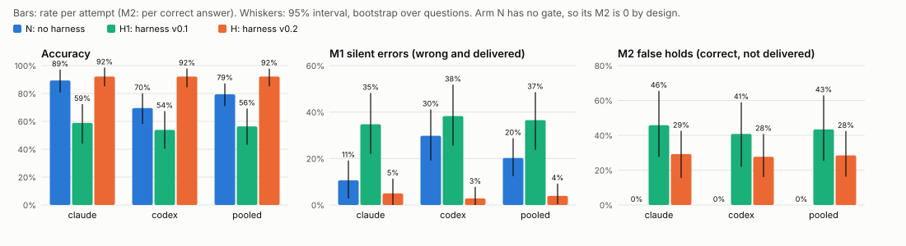

# E1b 报告（中文摘要）：harness v0.2 在新盲题上的检验

英文全文见 [REPORT.md](REPORT.md)，数字以英文版为准。2026-11-06 22:46 至 11-07 约 02:20（CST）在与 E1 相同的
合成订阅公司数据上运行，共 846 次尝试：2 个 agent × 3 组 × 47 道新盲题 × 每题 3 次，全部完成，没有基础设施重试。
方案在第一次尝试前登记在 [PREREGISTRATION.md](PREREGISTRATION.md)，改动和标注说明记在 [DEVIATIONS.md](DEVIATIONS.md)。

## 结论

1. **静默错误降到不用 harness 时的五分之一，但正确答案仍被拦得太多。** 两个 agent 合计，答错却被当作可信结果交付的比例（M1）：
   不用 harness（N 组）20.2%，**harness v0.2（H 组）3.9%**，harness v0.1（H1 组）36.5%。H − N 配对差 −16.3 个百分点，
   95% 区间 −25.2 到 −7.1（比值 0.19）。但 H 组暂缓了 28.5% 的正确答案（M2）。判定：**D1 未达成**（只差 M2 这一条），
   **D4 达成**：仍然太严，还不能宣称价值。**D5 达成**：v0.2 的修复在新题上有效（M1 比 v0.1 低 32.6 个百分点，
   区间 −45.4 到 −20.6；M2 28.5% 对 43.4%）。**D6 未达成**：直接题上 v0.2 没有交付任何错答案（90 次中 0 次）。
2. **H 组的 11 次静默错误全部是 harness 自己造成的，v0.3 的修复全部覆盖。** 这 11 次里 agent 都算出了正确的单个值
   （某个区域的占比、最高的月份、两个月之差），但 v0.2 的 derive 步骤不肯核验这个单值，agent 于是改交门禁能核验的行
   （所有区域的占比、全部十二个月），结果错误地被交付。[H_v0.3_PLAN.md](../H_v0.3_PLAN.md) 中的 F15、F16 补上了这两个缺口，
   每项都有用这些尝试重建的回归测试。不是 harness 造成的 10 个错答案全部被拦下。
3. **大多数误拦来自治理指标覆盖不到的问题。** H 组拦下的 74 个正确答案中，56 个回答的是没有治理指标的问题
   （注册数、工单、观看时长、套餐价格、全年去重流失人数），harness 只能暂缓。7 个已经 VERIFIED，但最终答案把数字重写了
   （提交 611761，报告 611761.0），普查按字节比对，判为未交付；10 个碰到 derive 的两个缺口（累计值、月减月）。
   即使这些全部修好，M2(H) 也约为 22%：**卡住 D1 的是覆盖面，不是门禁逻辑。**
4. **agent 自己犯的错与 E1 相同。** 不用 harness 时，Codex 有 37 次错答案出自月初边界错误（把月初 00:00 开始的订阅算作月初活跃），
   分布在 47 道题中的 18 道；其中 12 次它先打印过正确值。Claude Code 的错答案是格式问题（12 次）和一道有歧义的题（3 次）。
   用 harness 时，治理指标在其覆盖的题上消除了边界错误：正确率 92.2%（H）对 79.4%（N）。

## 预注册结果（合计）

| 组 | 正确率 | M1 静默错误 | M2 误拦 | 弃答 | M4 连续 3 次全对 |
|---|---|---|---|---|---|
| N 不用 harness | 79.4% [70.9, 87.2] | **20.2%** [12.4, 28.7] | 0% | 0.4% | 0.72 |
| H1 harness v0.1 | 56.4% [43.3, 69.1] | **36.5%** [23.8, 48.6] | 43.4% [25.5, 62.9] | 31.6% | 0.54 |
| H harness v0.2 | 92.2% [85.1, 97.9] | **3.9%** [0.4, 9.2] | **28.5%** [16.3, 42.4] | 27.3% | 0.89 |

每行 282 次尝试；方括号是对 47 道题做 2,000 次 bootstrap 的 95% 区间。分 agent 的结果、成本和耗时见英文版。

| 规则 | 条件 | 数值 | 是否达成 |
|---|---|---|---|
| D1 | M1(H) ≤ 0.8 × M1(N)，配对差区间上限 < 0，且 M2(H) ≤ 15% | 比值 0.19；区间 [−25.2, −7.1]；**M2 28.5%** | **否** |
| D4 | M2(H) > 15% | 28.5% | **是** |
| D5 | M1(H) − M1(H1) 区间上限 < 0，且 M2(H) < M2(H1) | −32.6 [−45.4, −20.6]；28.5% < 43.4% | **是** |
| D6 | 直接题上 M1(H) > M1(H1) + 5 个百分点 | 0.0% 对 2.2% | **否** |

## 错误标签

设计者给全部 203 次错答案各标一个主标签；Haiku 5.5 盲标随机 30%（61 次）。一致率 75%，**Cohen's κ = 0.62**（E1 为 0.58）。

| 标签 | N: claude | N: codex | H1: claude | H1: codex | H: claude | H: codex |
|---|---|---|---|---|---|---|
| E-fmt 答案形状 | 12 | 5 | 49 | 55 | 8 | 4 |
| E-time 期间 / 边界 | 0 | 37 | 0 | 4 | 0 | 4 |
| E-unit 分 / 元 | 0 | 0 | 3 | 3 | 0 | 0 |
| E-read 读错题 | 0 | 0 | 3 | 0 | 0 | 0 |
| E-proc 过程 | 0 | 1 | 0 | 0 | 0 | 0 |
| E-other（C-H11） | 3 | 0 | 3 | 3 | 3 | 3 |
| **错答案合计** | **15** | **43** | **58** | **65** | **11** | **11** |
| 其中 harness 造成 | — | — | 52 | 57 | 8 | 4 |
| 其中被交付（静默错误） | 15 | 42 | 49 | 54 | 7 | 4 |

与 E1 一样，没有任何一组的错误落在事先埋入的仓库缺陷标签上。

## 探索性分析：H 组为什么暂缓了 74 个正确答案

| 原因 | 次数 | 如何改变 |
|---|---|---|
| 没有治理指标覆盖（预注册的 8 道"无指标"题） | 38 | 覆盖面，不是门禁 |
| "平均月套餐价格"：分类器归为 ARPU 上的一步，但目录里没有套餐价格指标（C-H13、C-L11） | 12 | 覆盖面 |
| 全年去重流失人数：月度流失数不能相加成去重人数（C-H14） | 6 | 覆盖面 |
| 已 VERIFIED，但最终答案重写了数字，普查找不到对应提交（C-H28、C-H12、C-L34） | 7 | 普查按数值比对（v0.3 S2） |
| 逐月累计值：derive 没有累计（C-H32） | 6 | F17（v0.3） |
| 一个月减另一个月（C-H31） | 4 | F16（v0.3） |
| 其他（C-L14） | 1 | — |

明细见 [hold_reasons.md](hold_reasons.md)。这些数字是探索性的，不改变 D1 的判定。

## 敏感性分析（都不改变判定）

- **评分器**：10 个答案数值正确但评分器读不了（0.0580 等末尾零被 JSON 解析掉 5 次；套餐名写成"Plus版"4 次；全年键写成"2025"1 次）。
  计为正确时 M1：N 17.0%，H1 36.5%，H 3.9%。
- **题目 C-H11**：真值只统计 2 月 1 日活跃订阅者开的工单（682 / 3,497），而题面写的是工单总数，所有组的所有 agent
  都按全部非测试工单计算（730 / 3,497）。去掉这道题时 M1：N 18.5%，H1 37.3%，H 4.0%。
- **普查按数值匹配**：H 组 7 个、H1 组 0 个正确答案会改判为已交付，M2(H) 从 28.5% 变为 25.8%。
- **披露**：N 组的仓库副本里 `bronze_safe` 视图无法读取（E1 也一样）；282 次 N 组尝试中 **0 次** 查询过它，结果不受影响。v0.3 已修复。

## 下一步

- **H v0.3**：F15（只报一个被点名的组的占比或差值时可以核验；拒绝信息会提示 `derive.keep`）、F16（跨月份的 top / 差值）、
  F17（累计值 `months: cumsum`）、S2（审计和普查按数值比对最终答案与提交），以及搭建 E3a 时发现的仓库和上下文修复。
  在写任何 E3a 题目之前冻结。
- **覆盖面是没解决的问题**：74 次误拦中有 56 次是治理指标覆盖不到的答案。v0.4 的选项：为常见问题补治理指标；给非治理答案一个
  较弱的单独交付等级（独立重算、月初边界探针）；或者明确交给人工复核，并把这部分成本与 M2 分开计量。
- **E3a**：在真实公开数据（UCI Online Retail II）上用新盲题比较 v0.3 与不用 harness。

## 局限

47 道题、2 个 agent、一个由设计者编写的合成世界，只能检出大效应；Claude 单独看 H − N 不显著（−5.7，区间 −16.3 到 +4.3）。
题型由一个模型在运行前分类，至少 2 道题（套餐价格）归错了组。标签由按同一指南工作的子代理完成，κ 0.62。
M3 在两个 agent 之间不可比（美元对 token）。
