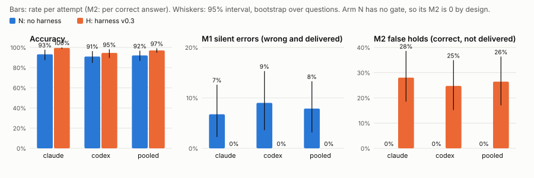
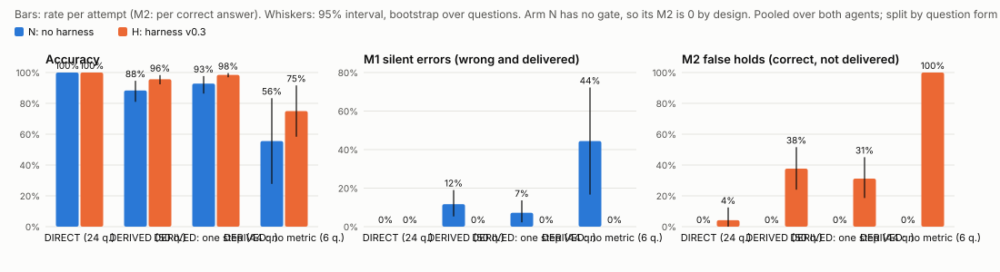
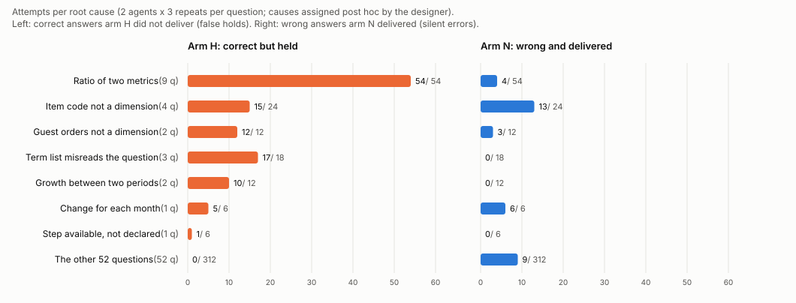

# E3a report: harness v0.3 on real retail data (UCI Online Retail II)

[中文摘要](REPORT.zh-CN.md)

Main run 2026-11-07 03:28 to about 06:29 (CST): 888 attempts, 2 agents × 2 arms (N, H) × 74 blind
questions × 3 repeats, all completed (status OK, no infrastructure retries). The data is a disguised
copy of the UCI Online Retail II export (dates shifted +14 years, columns renamed), loaded into the
same warehouse layout as E1, with a retail semantic model written for it ([ONBOARDING.md](../../../experiments/E3a/ONBOARDING.md)).
The plan was fixed in [PREREGISTRATION.md](PREREGISTRATION.md) before the first attempt; changes are
in [DEVIATIONS.md](DEVIATIONS.md). Numbers come from `experiments/E1/analyze.py --rules e3a`; the
exploratory tables from `experiments/E3a/false_holds.py`, `experiments/E1b/hold_reasons.py`,
`experiments/E1b/delivery_match.py` and `experiments/H_v04/agreement_probe.py`
(`experiments/E3a/post_run.sh` runs them in order). The control run (N-orig: arm N on the original
column names and years, 444 attempts, 06:31–07:37) is reported in its own section.

## Summary

1. **On real data the harness delivered no wrong answer, and still held a quarter of the right
   ones.** Pooled over both agents, silent errors (M1) were 7.9% without the harness (N) and
   **0.0% with harness v0.3 (H)**; paired difference −7.9 points, 95% interval −13.3 to −3.4. But H
   held 26.5% of its correct answers (M2). **R1 not met** (only its M2 condition fails), **R2 met**
   (too strict on real data), **R3 not met**: on DIRECT questions neither arm made a single error
   (0 of 144 each), so there was nothing to reduce.
2. **Every false hold sits in 22 of the 74 questions, whose shape the harness cannot check.** On the
   other 52 questions arm H delivered 312 of 312 attempts, all correct. The 22 are ratios of two
   metrics (per customer, per order, share of customers: 54 holds), top products by item code and
   guest-order shares (no such dimension in the model: 27), a semantic-model term list that misreads
   the question (毛产品销售额 read as net sales, "customers who had already bought" read as active
   customers: 17), growth between two periods or for each month (the derive step compares the first
   and last month: 15), and one undeclared step. Each has a concrete fix
   ([false_holds.md](false_holds.md)); none needs a looser gate.
3. **Most of arm N's silent errors are right values the registered grader cannot read.** Of 35, 24
   have the right numbers with an `item_code` key where the bank says `sku` (13), a value rounded
   below 3 significant digits (−9.4 for −9.396, −0.32 for −0.318: 9) or a quarter label as the month
   key (2). The other 11 are real: Codex subtracted cancellation amounts that are already stored
   negative, adding cancelled value back (5), and both agents reported monthly ratios where one
   ratio over the period was asked (6). Counting the 24 as correct, M1(N) is **2.5%**; the
   harness-arm result does not change (0.0%).
4. **The harness caused 3 of arm H's 13 wrong answers, and held all 3.** A share step that returned
   only the member it named, the gross-to-net term misreading, and the growth step pushed agents
   off answers they had right (all three had the right value first). The other 10 wrong answers
   (8 grader cases, 2 that dropped item codes with a letter suffix) were also held. No harness
   error reached a user, but each is a v0.5 fix.
5. **Accuracy is higher with the harness and costs more.** Accuracy 97.1% (H) vs 92.1% (N); pass^3
   0.95 vs 0.89. Claude Code spent $0.054 per correct delivered answer with the harness vs $0.019
   without; Codex 440 k vs 96 k tokens. The harness arm's cost per delivered answer includes the
   held ones' cost.
6. **Real agents made far fewer errors here than on the synthetic world.** E1b's arm N had 20.2%
   silent errors on a world built to contain traps; E3a's has 7.9%, 2.5% of them substantive. The
   silver layer already removes the retail data's worst traps (duplicates, test and non-product
   lines); what is left is definitions (signed cancellations) and period arithmetic. The harness's
   value on clean real data is a smaller error rate to remove, at a cost that has to come down.
7. **The disguise changed nothing.** On the data as published (original names and years) arm N's M1
   was 8.3% against 7.9%, paired difference +0.5 points [−1.6, +2.7], with the same errors on the
   same questions. Remembering this public dataset did not help the agents, and the disguise did not
   make the task harder ([control](#control-n-orig-exploratory)).

## Setup

As in E1b: Claude Code 2.1.296 with Sonnet 5.5 (`claude`), Codex CLI 0.162.0-alpha.17.2 with
gpt-6-luna at high effort (`codex`), each attempt in a fresh bubblewrap sandbox with no repository,
no memories and no web. Frozen inputs (harness v0.3 file digests, truth build, bank sha256) were
re-checked after the run and are unchanged.

| arm | what the agent has | delivered means |
|---|---|---|
| N | warehouse copy (`bronze_safe`, `staging`, `silver`) + the retail data catalog + Python with duckdb | the agent says it succeeded |
| H | harness v0.3 analyst tools over the same warehouse, with the retail semantic model (10 governed metrics, dimensions month / market / country) | the final answer equals a VERIFIED / ALLOW submission, byte for byte or as numbers (S2) |

Questions: 74 kept of 80 written by two outside models that never saw the check code (Luna 37,
Haiku 37; 62 English, 12 Chinese). Blind classification before any attempt: 24 DIRECT (one governed
metric unchanged), 44 DERIVED with one governed step, 6 DERIVED with no governed metric. Truth from
an independent second build (build B) of the official definitions
([ADJUDICATION.md](../../../experiments/E3a/ADJUDICATION.md)). Grading as in E1 (keys exact; value
within 0.05% or half a unit of the last reported place, at least 3 significant digits; share ↔
percent accepted). Onboarding (raw file to a frozen semantic model and verified smoke answers): about
2.5 designer hours, with ten harness findings along the way ([ONBOARDING.md](../../../experiments/E3a/ONBOARDING.md)).

## Pre-registered results

| agent / arm | accuracy | M1 silent errors | M2 false holds | abstained | M4 pass^3 | M3 cost per correct delivered | median time |
|---|---|---|---|---|---|---|---|
| claude / N | 93.2% [87.4, 97.7] | 6.8% [2.3, 12.6] | 0% | 0.0% | 0.91 | $0.019 | 8 s |
| claude / H | 99.5% [98.6, 100.0] | 0.0% [0.0, 0.0] | 28.1% [18.6, 38.6] | 28.4% | 0.99 | $0.054 | 13 s |
| codex / N | 91.0% [84.7, 96.4] | 9.0% [3.6, 15.3] | 0% | 0.0% | 0.88 | 96 k tokens | 25 s |
| codex / H | 94.6% [89.6, 98.2] | 0.0% [0.0, 0.0] | 24.8% [15.2, 35.0] | 28.8% | 0.91 | 440 k tokens | 37 s |
| **pooled / N** | 92.1% [86.7, 96.8] | **7.9%** [3.2, 13.3] | 0% | 0.0% | 0.89 | — | 16 s |
| **pooled / H** | 97.1% [94.8, 99.1] | **0.0%** [0.0, 0.0] | **26.5%** [17.1, 36.4] | 28.6% | 0.95 | — | 23 s |

444 attempts per pooled row, 222 per agent row. Brackets: 95% intervals, bootstrap over the 74
questions (2,000 resamples, seed 20261106). M3 is USD for Claude (API-equivalent) and tokens for
Codex (subscription), so it is not pooled. Arm N has no gate, so its M2 is 0 by construction.

Paired difference in M1, H − N: claude −6.8 [−12.6, −2.3], codex −9.0 [−15.3, −3.2], **pooled −7.9
[−13.3, −3.4]**.

### Decision rules

| rule | condition | value | met? | meaning |
|---|---|---|---|---|
| R1 | pooled M1(H) ≤ 0.8 × M1(N), upper end of the paired interval below 0, and M2(H) ≤ 15% | 0.0% vs 7.9% (ratio 0); interval [−13.3, −3.4]; **M2 26.5%** | **no** | the gate does not yet hold up on real data |
| R2 | M2(H) > 15% | 26.5% | **yes** | too strict on real data |
| R3 | on DIRECT questions, M1(H) < M1(N) and the upper end of the paired interval below 0 | 0.0% vs 0.0% | **no** | nothing to reduce: no agent erred on a DIRECT question |

As in E1b, two of R1's three conditions are met with room to spare and the false-hold rate alone
fails it. R1 stands as not met.

### Secondary (pre-registered): by question form

| form | questions | N accuracy | N M1 | H accuracy | H M1 | H M2 |
|---|---|---|---|---|---|---|
| DIRECT | 24 | 100.0% | 0.0% | 100.0% | 0.0% | 4.2% [0.0, 12.5] |
| DERIVED, one governed step | 44 | 92.8% | 7.2% [2.3, 13.6] | 98.5% | 0.0% | 31.2% [18.6, 45.0] |
| DERIVED, no governed metric | 6 | 55.6% | 44.4% [16.7, 72.2] | 75.0% | 0.0% | 100% |

The DIRECT M2 of 4.2% is one question (R-H37, below: the term list reads "customers who had already
bought" as active customers). Arm N's low accuracy on questions with no governed metric is mostly the
grader: 13 of its 16 wrong answers there are right top-5 lists keyed `item_code`.

### Delivery rule (S2 beside byte for byte)

317 arm-H answers are delivered under either rule: every delivered final answer is byte-identical to
a VERIFIED / ALLOW submission except one (Codex), which matches one as numbers only. E3a's M2 is
therefore comparable with E1b's (which used the byte rule): 26.5% vs 28.5%.

## Error labels

The designer labelled all 48 wrong attempts (35 N, 13 H) with one primary label
([LABEL_GUIDE.md](../../../experiments/E1/LABEL_GUIDE.md), retail meanings fixed in advance in
[LABEL_NOTES.md](../../../experiments/E3a/LABEL_NOTES.md)); Haiku 5.5 labelled a random 30% (14)
blind. Agreement 9 of 14 (64%), **Cohen's κ = 0.42**. All 5 disagreements are about which label a
presentation failure gets, none about a data error: 4 values rounded below 3 significant digits
(designer E-fmt with a `grader?` note, as E1 and E1b; Haiku E-other, "no label covers precision") and
one set of monthly shares where one period share was asked (designer E-calc by the guide's rule for
monthly rows without the period value in the notes; Haiku E-fmt).

| label | N: claude | N: codex | H: claude | H: codex | what it was |
|---|---|---|---|---|---|
| E-fmt, `grader?` | 12 | 12 | 0 | 8 | right values: `item_code` for `sku` (13 N, 7 H), rounded below 3 significant digits (9 N, 1 H), quarter label as month (2 N) |
| E-refund | 0 | 5 | 0 | 0 | cancellation amounts stored negative, subtracted again (net sales too high by twice the cancellations) |
| E-calc | 3 | 3 | 0 | 0 | monthly ratios where one ratio over the period was asked (guest share Jun–Aug; net sales per customer Oct–Dec) |
| E-test | 0 | 0 | 0 | 2 | kept only five-digit item codes, dropping product codes with a letter suffix (85123A, 85099B) |
| E-fmt | 0 | 0 | 1 | 1 | harness-induced: only the UK share resubmitted after the share step dropped non-UK; six monthly rows after the growth step refused 22.47% |
| E-def | 0 | 0 | 0 | 1 | harness-induced: switched from gross to net sales after the gate read 毛产品销售额 as net |
| **total** | 15 | 20 | 1 | 12 | |

**Harness-induced** (arm H): 3 of 13, all held (0 delivered). In each the agent had the right value
first; the harness then (a) recomputed a share for the named member only (`derive.across.a = UK`)
and FAILED an answer that also gave the non-UK share, (b) told the agent the question asked about
net sales because the model's terms lack 毛产品销售额, (c) recomputed "growth" from the first and
last month of the declared range (99.5%) and FAILED the right quarter-on-quarter growth (22.47%).

**Grader sensitivity** (exploratory, the 32 `grader?` attempts counted as correct): accuracy 97.5%
(N) and 98.9% (H); M1 2.5% (N) and 0.0% (H); M2(H) 27.8%. The grader stays as registered.

## Exploratory: why arm H held 114 correct answers

The designer read the evidence behind every correct-but-held attempt (the certificate of the final
rows, the reconcile reasons and contradictions) and assigned each question one root cause
([false_holds.md](false_holds.md), `experiments/E3a/false_holds.py`; post hoc). 48 of the 114 were
held with a failed check, 66 as inconclusive.

| root cause | questions | H correct held | N silent errors (`grader?`) | candidate fix |
|---|---|---|---|---|
| ratio of two metrics (per customer, per order, share of customers) | 9 | 54 of 54 | 4 (1) | a derive step over two declared metric calls, both recomputed |
| item code not a dimension (top-5 products) | 4 | 15 of 24 | 13 (13) | item-code dimension at onboarding; an ungoverned key column reads INCONCLUSIVE before the shape check |
| guest orders not a dimension | 2 | 12 of 12 | 3 (0) | customer-type dimension at onboarding |
| term list misreads the question | 3 | 17 of 18 | 0 | term-coverage test on paraphrased questions at onboarding; a generic term never contradicts a declared metric that refines it |
| growth between two periods | 2 | 10 of 12 | 0 | growth over two month windows, each rolled up by the metric's rule |
| change for each month | 1 | 5 of 6 | 6 (6) | per-month change step that keeps one row per month (base: the month before) |
| step available, not declared | 1 | 1 of 6 | 0 | none (agent) |
| **the other 52 questions** | 52 | **0 of 312** | 9 (4) | |

Two things stand out. First, the gate's logic is not what holds correct answers: where a governed
metric and a derive step reach, arm H delivered every attempt and every one was right. Coverage is
what keeps R1 out of reach, as in E1b. Second, most of the uncovered shapes are ordinary business
questions (per customer, per order, quarter on quarter), and four of the seven causes are fixed in
the semantic model at onboarding, not in the gate. When a ratio was uncovered, agents split between
declaring nothing (30, INCONCLUSIVE) and declaring the numerator metric (24), which reconcile then
compared with the ratio and FAILED (10.9% against 108 new customers). The FAILs matter beyond M2:
any second-opinion rule that refuses answers the oracle contradicts (below) cannot release them.

## Exploratory: a second agent's answer as a check (H v0.4 replay)

Replayed from the finished attempts (nothing re-run), as on E1 / E1b
([agreement_E3a.md](../H_v0.4/agreement_E3a.md), rules defined in
[H_v0.4_PLAN.md](../H_v0.4_PLAN.md) before any E3a result was read; DEVIATIONS 03:40 and 04:57).

| arm / rule | delivers when | M1 | M2 | extra runs |
|---|---|---|---|---|
| N / recorded | the agent says so | 7.9% | 0% | 0% |
| N / cross | the other agent's answer agrees | 0.5% | 4.6% | 100% |
| H / recorded | VERIFIED + ALLOW | 0.0% | 26.5% | 0% |
| H / hybrid | recorded, or else the other agent's harness answer agrees (grader's reading) | 0.0% | 3.0% | 29% |
| H / t2 | hybrid, and the held answer's own checks are eligible (static and re-execution PASS, reconcile not FAIL) | 0.0% | 12.8% | 18% |
| H / t2x | t2 with v0.4's own comparator on raw rows (column names must match) | 0.0% | 18.7% | 18% |
| H / t2n | t2x, the second opinion being the other agent's arm-N attempt | 0.6% | 14.8% | 18% |

A second agent cuts M2 to 3% at the price of a second run on 29% of questions, with no silent error,
but only when agreement alone decides. The eligibility rule that keeps a contradicted answer held
(t2) leaves 12.8%, and the false FAILs above are most of the difference: an answer FAILED for
comparing a ratio with a count cannot be released by any agreement. Fixing the false FAILs first and
then adding the second opinion is the order this suggests. t2n's 0.6% silent errors are the grader
again, not a wrong number: Codex's arm-H top-5 lists keyed `item_code` (right values) confirmed by
Claude's arm-N lists keyed the same way (R-H09: 2 attempts, R-H29: 2 attempts at one in three).

## Control: N-orig (exploratory)

Arm N again, on the data as published: the original column names (`Invoice`, `StockCode`,
`Customer ID`, `Price`, ...) and dates, with the same questions in the original years
(`bank_control.yaml`). The question was whether agents do better on a public dataset they may have
seen in training. 444 attempts, all completed, none retried. Pre-registered as exploratory, never a decision.

| agent | accuracy, original | M1, disguised (arm N) | M1, original (N-orig) | paired difference, original − disguised |
|---|---|---|---|---|
| Claude Code | 91.4% | 6.8% | 8.6% [3.2, 15.3] | +1.8 points [−1.4, +5.4] |
| Codex | 91.9% | 9.0% | 8.1% [3.2, 14.4] | −0.9 points [−3.6, +1.8] |
| pooled | 91.7% [85.6, 96.6] | 7.9% [3.4, 12.8] | 8.3% [3.4, 14.4] | **+0.5 points [−1.6, +2.7]** |

| wrong attempts, by kind | disguised (designer labels) | original (grader's reason) |
|---|---|---|
| key column not named `sku` (right values) | 13 | 18 |
| rounded below 3 significant digits | 9 | 10 |
| quarter label as the month key | 2 | 2 |
| monthly rows for a whole-period value | 6 | 6 |
| cancellations subtracted twice | 5 | 0 |
| another wrong value | 0 | 1 |
| total | 35 | 37 |

The published names and years neither helped nor hurt. M1 moved by half a point and the paired
interval spans zero. The errors fall on the same questions (the top-5 item lists, the guest-order
shares by month, the −9.396% change) and are the same kinds. The one visible difference is Codex's
double-counted cancellations: 5 attempts on the disguised copy, none on the original. With three
attempts per question that may be chance. So the disguise did not make the task harder, and memory
of this dataset is not what kept arm N's error rate low; the comparison with arm H stands as reported.
Substantive errors (excluding the first three rows) are 11 of 444 (2.5%) disguised and 7 of 444 (1.6%)
original. The control was not labelled by the designer; its kinds come from the grader's reason for
each attempt.

## What changes next

1. **Harness v0.5 ([plan](../H_v0.5_PLAN.md); from this run, to be tested on a fresh bank):** a ratio of two declared metric
   calls; growth between two month windows; a per-month change step; a share step that reports
   every member unless `keep` names some; a generic term never contradicting a declared metric that
   refines it; an ungoverned key column read as INCONCLUSIVE before the shape check. Each gets a
   regression test built from these attempts. v0.4 (the second opinion, T2) is ready as a patch and
   goes in first.
2. **Onboarding:** item-code and customer-type dimensions; a term-coverage check that runs the
   model's terms against paraphrased questions written by a model that has not seen the terms.
   Onboarding quality is now visibly a false-hold cause, so the onboarding procedure is part of the
   product.
3. **Benchmark:** the next bank's prompt states the key column names and asks for full precision,
   and the grader's alias list includes `item_code`, decided before E4 runs; 24 of 35 arm-N
   "errors" here were presentation.
4. **E4** (to be pre-registered): arms N and H on a fresh retail bank weighted towards the shapes
   that held answers here, with v0.4 + v0.5; T2 from the other agent's arm-N attempt.

## Limits

- One dataset, one company shape (a UK gift wholesaler), 74 questions from two authors; DIRECT
  questions were easy for both agents, so R3 could not discriminate.
- The root causes of false holds were assigned after reading the evidence; the fixes were found on
  this bank and are not evidence that they work until a fresh bank tests them.
- The data is public and may be in the agents' training data. The disguise (shifted dates, renamed
  columns) and the N-orig control address this: on the original data arm N's M1 moved by half a
  point (paired interval −1.6 to +2.7), but a control cannot show what the agents remember about
  the business itself.
- κ = 0.42 on 14 blind sheets is a small sample; the disagreements are all about presentation
  labels.
