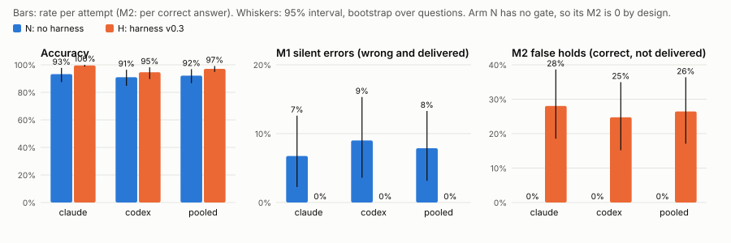
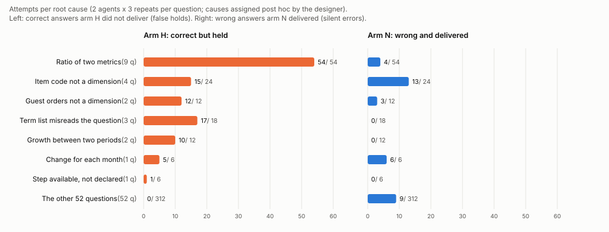

# E3a 报告（中文摘要）：harness v0.3 在真实零售数据（UCI Online Retail II）上的检验

英文全文见 [REPORT.md](REPORT.md)，数字以英文版为准。主运行 2026-11-07 03:28 至约 06:29（CST），共 888 次尝试：
2 个 agent × 2 组（N、H）× 74 道盲题 × 每题 3 次，全部完成，没有基础设施重试。数据是 UCI Online Retail II 的伪装副本
（日期平移 14 年、列名改过），放进与 E1 相同的仓库分层，并为它写了零售语义模型。方案在第一次尝试前登记在
[PREREGISTRATION.md](PREREGISTRATION.md)，改动记在 [DEVIATIONS.md](DEVIATIONS.md)。对照组（N-orig：用原始列名和年份的 N 组，
444 次尝试，06:31–07:37）的结果见下文。

## 结论

1. **在真实数据上，harness 没有交付一个错答案，但仍拦下了四分之一的正确答案。** 两个 agent 合计，静默错误（M1）：
   不用 harness（N 组）7.9%，**harness v0.3（H 组）0.0%**；配对差 −7.9 个百分点，95% 区间 −13.3 到 −3.4。
   但 H 组暂缓了 26.5% 的正确答案（M2）。判定：**R1 未达成**（只差 M2 这一条），**R2 达成**（在真实数据上太严），
   **R3 未达成**：直接题上两组都一次没错（各 144 次中 0 次），没有可以降低的错误。
2. **所有误拦都集中在 74 道题中的 22 道，这些题的形式 harness 核验不了。** 其余 52 道题上，H 组 312 次尝试全部交付，全部正确。
   这 22 道题是：两个指标之比（每客户、每订单、客户占比：54 次）；按商品编码排前五、游客订单占比（模型里没有这两个维度：27 次）；
   语义模型的术语表读错了题（"毛产品销售额"被读成净销售额，"之前买过的客户"被读成活跃客户：17 次）；
   两个时段之间的增长或逐月变化（derive 只比较首尾两个月：15 次）；以及 1 次没有声明已有的步骤。
   每一类都有具体的修法（[false_holds.md](false_holds.md)），没有一类需要放松门禁。
3. **N 组的静默错误多数是数值正确、但登记的评分器读不了。** 35 次中有 24 次数字是对的：用 `item_code` 而不是题库的 `sku`
   作键（13 次）、四舍五入到不足 3 位有效数字（−9.396 写成 −9.4：9 次）、用季度标签当月份键（2 次）。真正算错的 11 次：
   Codex 把已经存成负数的取消金额又减了一次，等于把取消额加回去（5 次）；两个 agent 都在问整段时期比值时报了逐月比值（6 次）。
   把这 24 次算作正确，M1(N) 为 **2.5%**；H 组结果不变（0.0%）。
4. **H 组 13 个错答案中有 3 个是 harness 造成的，3 个全部被拦下。** 占比步骤只返回它点名的成员、毛/净术语误读、增长步骤
   这三处把 agent 从已经算对的答案推开（三次都先算出了正确值）。另外 10 个错答案（8 个评分器读不了的，2 个丢掉了带字母后缀的商品编码）
   也都被拦下。没有一个 harness 错误到达用户，但每一处都是 v0.5 要修的。
5. **用 harness 正确率更高，成本也更高。** 正确率 97.1%（H）对 92.1%（N）；连续 3 次全对 0.95 对 0.89。Claude Code 每个
   正确交付的答案花费 $0.054（不用 harness 为 $0.019）；Codex 440 k 对 96 k tokens。
6. **真实 agent 在这里犯的错比在合成世界里少得多。** E1b 的 N 组在故意埋了陷阱的世界里静默错误 20.2%；E3a 是 7.9%，
   其中实质性错误只有 2.5%。silver 层已经去掉了零售数据最大的坑（重复行、测试和非商品行），剩下的是定义（带符号的取消额）
   和时段算术。在干净的真实数据上，harness 要去掉的错误更少，而成本必须降下来。
7. **伪装没有改变结果。** 在原样发布的数据上（原始列名和年份），N 组静默错误 8.3%，伪装数据上 7.9%，
   配对差 +0.5 个百分点（区间 −1.6 到 +2.7），错在同样的题、同样的类型。agent 记得这个公开数据集并没有帮上忙，
   伪装也没有让题变难。

## 预注册结果（合计）

| 组 | 正确率 | M1 静默错误 | M2 误拦 | 弃答 | M4 连续 3 次全对 |
|---|---|---|---|---|---|
| N 不用 harness | 92.1% [86.7, 96.8] | **7.9%** [3.2, 13.3] | 0% | 0.0% | 0.89 |
| H harness v0.3 | 97.1% [94.8, 99.1] | **0.0%** [0.0, 0.0] | **26.5%** [17.1, 36.4] | 28.6% | 0.95 |

每行 444 次尝试；方括号是对 74 道题做 2,000 次 bootstrap 的 95% 区间。分 agent 的结果、成本和耗时见英文版。

| 规则 | 条件 | 数值 | 是否达成 |
|---|---|---|---|
| R1 | M1(H) ≤ 0.8 × M1(N)，配对差区间上限 < 0，且 M2(H) ≤ 15% | 比值 0；区间 [−13.3, −3.4]；**M2 26.5%** | **否** |
| R2 | M2(H) > 15% | 26.5% | **是**：在真实数据上太严 |
| R3 | 直接题上 M1(H) < M1(N) 且配对区间上限 < 0 | 0.0% 对 0.0% | **否**：两组直接题都没错 |

## 误拦的根因（探索性，事后归因）

被拦下的 114 个正确答案中，48 个有检查判 FAIL，66 个是"无法判定"。按题归因后：门禁逻辑本身没有拦错东西，
凡是治理指标和 derive 步骤够得着的题，H 组每次都交付、每次都对；卡住 R1 的是覆盖面，这和 E1b 一样。
七类根因中有四类要在接入数据时（语义模型）修，而不是在门禁里修。

## 第二个 agent 的答案作为核验（v0.4 回放，探索性）

H 组在"门禁通过，否则另一个 agent 的答案一致就交付"规则下，M2 降到 3.0%，没有静默错误，代价是 29% 的题要多跑一次。
要求被拦答案自身检查合格（重算一致、对账不判 FAIL）后 M2 为 12.8%，差距主要来自上面的误判 FAIL：
一个把比值和计数相比而判 FAIL 的答案，任何一致性规则都放不出来。所以顺序应该是先修误判 FAIL，再加第二意见。

## 对照组：N-orig（探索性）

N 组在原样发布的数据上再跑一遍：原始列名（`Invoice`、`StockCode`、`Customer ID`、`Price` 等）和原始日期，
题目相同，年份改回原来的年份。444 次尝试全部完成，没有重试。

| agent | 原始数据正确率 | M1，伪装数据（N 组） | M1，原始数据（N-orig） | 配对差，原始 − 伪装 |
|---|---|---|---|---|
| Claude Code | 91.4% | 6.8% | 8.6% [3.2, 15.3] | +1.8 [−1.4, +5.4] |
| Codex | 91.9% | 9.0% | 8.1% [3.2, 14.4] | −0.9 [−3.6, +1.8] |
| 合计 | 91.7% [85.6, 96.6] | 7.9% [3.4, 12.8] | 8.3% [3.4, 14.4] | **+0.5 [−1.6, +2.7]** |

| 错误类型 | 伪装数据（设计者标注） | 原始数据（评分器给出的原因） |
|---|---|---|
| 键列不叫 `sku`（数值正确） | 13 | 18 |
| 四舍五入到不足 3 位有效数字 | 9 | 10 |
| 用季度标签当月份键 | 2 | 2 |
| 问整段时期却给了逐月行 | 6 | 6 |
| 取消额被减了两次 | 5 | 0 |
| 其他数值错误 | 0 | 1 |
| 合计 | 35 | 37 |

原始列名和年份既没有帮忙也没有添乱：M1 只差半个百分点，配对区间跨过零；错误落在同样的题上（商品编码前五、
按月的游客订单占比、−9.396% 的变化），类型也一样。唯一看得见的差别是 Codex 把取消额减两次（伪装数据上 5 次，
原始数据上 0 次），每题只有 3 次尝试，可能是偶然。实质性错误（去掉前三行）：伪装 11/444（2.5%），原始 7/444（1.6%）。
对照组没有做设计者标注，类型取自评分器对每次尝试给出的原因。

## 接下来

1. **harness v0.5**（[计划](../H_v0.5_PLAN.md)；来自本次运行，要在新题库上检验）：两个指标之比、两个时段之间的增长、逐月变化步骤、占比步骤默认报告全部成员、
   泛化术语不与细化它的已声明指标冲突、未治理的键列在形状检查之前判为"无法判定"。v0.4（第二意见 T2）补丁已就绪，先合入。
2. **数据接入**：加商品编码和客户类型维度；用没见过术语表的模型改写题目，检查术语覆盖。接入质量已经明确是误拦的来源，
   接入流程本身就是产品的一部分。
3. **基准**：下一套题的提示写明键列名、要求完整精度，评分器的别名表加入 `item_code`，在 E4 运行前定下。
4. **E4**（待预注册）：N 和 H 两组，新零售题库，偏重这次被拦的题型，使用 v0.4 + v0.5；T2 用另一个 agent 的 N 组答案。
