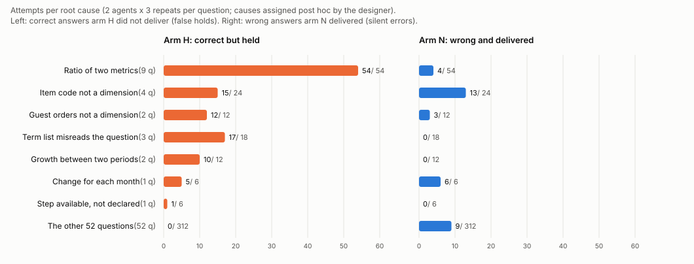

# E3a false holds by root cause (exploratory, generated by false_holds.py)

Arm H held 114 correct answers (48 with a failed check, 66 inconclusive). All of them are on the 22 questions below; on the other 52 questions arm H delivered 312 of 312 attempts, all correct, and held none. The same 22 questions carry 26 of arm N's 35 silent errors (24 of the 35 are right values the registered grader cannot read, designer note `grader?`). Causes were assigned by the designer after reading the evidence (post hoc); fixes found here must be tested on a fresh bank.

| root cause | questions | H correct held (FAIL / INCONCL.) | H wrong (all held) | N silent errors (of which grader?) | candidate fix | where |
|---|---|---|---|---|---|---|
| Ratio of two metrics | 9 | 54 of 54 (24 / 30) | 0 | 4 of 54 (1) | a derive step over two declared metric_calls (ratio of the governed rows, both recomputed) | harness |
| Item code not a dimension | 4 | 15 of 24 (2 / 13) | 9 | 13 of 24 (13) | add an item-code dimension in onboarding; read an ungoverned key column as INCONCLUSIVE before the shape check | onboarding + harness |
| Guest orders not a dimension | 2 | 12 of 12 (3 / 9) | 0 | 3 of 12 (0) | add a customer-type dimension in onboarding | onboarding |
| Term list misreads the question | 3 | 17 of 18 (4 / 13) | 1 | 0 of 18 (0) | term coverage test on paraphrased questions at onboarding; generic terms must not contradict a declared metric that refines them | onboarding + harness |
| Growth between two periods | 2 | 10 of 12 (10 / 0) | 2 | 0 of 12 (0) | a growth step over two month windows (each rolled up by the metric's rule) | harness |
| Change for each month | 1 | 5 of 6 (4 / 1) | 1 | 6 of 6 (6) | a per-month change step (base: the month before), like cumsum | harness |
| Step available, not declared | 1 | 1 of 6 (1 / 0) | 0 | 0 of 6 (0) | none (agent) | agent |
| other questions | 52 | 0 of 312 | 0 | 9 of 312 (4) | | |

## What went wrong, per cause

- **Ratio of two metrics** (R-L11, R-L13, R-L19, R-L20, R-L31, R-L33, R-L39, R-H13, R-H30): per customer, per order, share of customers: no governed metric and no derive step combines two metrics, so agents either declared nothing (INCONCLUSIVE) or declared the numerator, which reconcile then compared with the ratio (FAIL: 10.9% vs 108 new customers).
- **Item code not a dimension** (R-H09, R-H29, R-H39, R-L30): top-N products by item code: sku is not a governed dimension, so nothing can re-compute the list; two attempts that declared a month range got the shape FAIL before the dimension gap.
- **Guest orders not a dimension** (R-H10, R-H34): share of sales from guest orders (no customer number): no guest/identified dimension.
- **Term list misreads the question** (R-H08, R-L40, R-H37): the model's terms lack 毛产品销售额, so the generic 销售额 marks net sales as asked; 'customers ordered ... who had already bought' matches the active-customer term, not repeat; the contradiction then blocks a correct gross or repeat-customer answer.
- **Growth between two periods** (R-L18, R-H14): Q2 to Q3 and Jan-Nov year on year: derive growth compares the first and last month of the declared range (99.5% vs the correct 22.5%).
- **Change for each month** (R-H07): month-over-month change per month: growth collapses the months; no step keeps one row per month.
- **Step available, not declared** (R-L34): a month's share of the quarter: across share over months exists; one attempt did not declare it.
