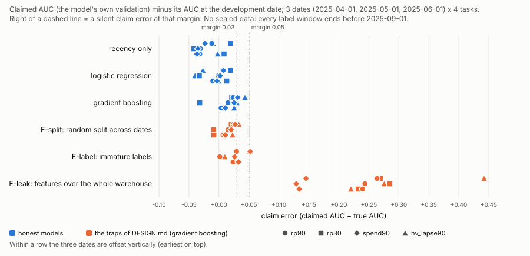

# E3b design: a repeat-purchase model on real data with a sealed final period

Draft, 2026-11-07 (night), written while E1b runs. Nothing here is pre-registered yet: E3b comes after
E3a, and the harness work it needs (v0.4, below) is not started. This page fixes the question, the
task and what counts as a silent error, so that v0.4 is built for a stated test.

Updated 2026-11-07 04:50 (CST): tasks, populations and labels are written
([`experiments/E3b/tasks.py`](../../../experiments/E3b/tasks.py)), and the designer's reference models and
the traps below were run on three development dates (section "Calibration"). Updated 05:48: a pilot
with real agents (section "Pilot") found none of the traps. Nothing on or after the sealed date was
read.

## Question

When an agent builds a predictive model on real data, how often does it deliver a model whose own
performance claim is wrong (leakage, a split that lets the future in, a mislabelled target), and
does the harness's leakage check plus sealed evaluation lower that rate without refusing sound models?

Analytics questions (E1, E3a) have one right number. A model has no right answer, only a true
out-of-time performance that nobody inside the sandbox can see. So the error measured here is the
**claim**, not the model: an honest weak model is fine; a model sold as AUC 0.90 that scores 0.70 on
the sealed months is the silent error.

## Data and task

The disguised Online Retail II world from E3a (2023-12-01 .. 2025-12-09, renamed columns, same
governed `silver.order_lines`).

- **Population at an as-of date `t`:** customers with at least one product purchase (line_type =
  product, net of cancellations) in the 365 days before `t`.
- **Label:** the customer makes another product purchase in `[t, t + 90 days)`: at least one
  product line, E3a's "active customer". A cancellation line has its own order number (`C…`) and
  does not name the order it cancels, so a later cancellation cannot be tied to a purchase and does
  not change the label. Labels come from E3a's adjudicated truth B.
- **Sealed period:** `t* = 2025-09-01`, label window 2025-09-01 .. 2025-11-29. The data ends
  2025-12-09, so late cancellations have 10 days to arrive. Agents never see any row on or after
  2025-09-01: their warehouse is a build with cutoff 2025-08-31.
- **What the agent delivers:** a score for every customer in the population at `t*` (computed only
  from data before `t*`), its own estimate of the AUC on that population with an interval, and a
  short model card (features, training as-of dates, validation method).

The trap is natural, not planted: a training frame at an earlier as-of date `t` needs features
from before `t` and labels from after it. A feature computed over the whole warehouse (total
spend, last purchase date, number of orders) leaks the label at every `t` except the last, so the
validation AUC is high and the sealed AUC is not. Other ways to be wrong: counting cancellation
lines as purchases, labels whose window runs past the cutoff (immature, mostly 0), a random split
across as-of dates, and validating on the population used for feature selection.

## Arms

Same agents as E1/E3a, same sandbox, k = 3.

| arm | what the agent has | delivered means |
|---|---|---|
| N | the 2025-08-31 build (`silver.order_lines`, catalog with definitions), Python with duckdb, pandas, scikit-learn (the census agent environment; LightGBM is not installed and the project adds no dependency) | the agent claims success and hands over scores + claim |
| H | harness data-science tools (v0.4) over the same build: `propose_feature` (time-safe SQL, leakage check), `train_candidate` (trusted template, out-of-time validation), `request_final_evaluation` (sealed, budgeted), `request_release` | the `model_shadow` gate returns ALLOW |

In arm H the sealed evaluation is the harness's own (a budgeted look at labels kept outside the
sandbox); its number is not the grading truth (below), which is computed once by the designer
after all attempts, on the same sealed period, with a fixed script.

## Truth and grading

- **Sealed AUC** of each delivered score table on the `t*` population, from the full data (cutoff
  2025-12-09), with a customer-level bootstrap interval. The script and the label SQL are frozen
  before the first attempt; the labels are built from the E3a adjudicated truth B, not from the
  harness pipeline.
- **Coverage:** the score table must cover the population (missing customers count as score 0 and
  are reported).
- **Reference models**, fixed before the first attempt: recency only (days since the last purchase),
  logistic regression and gradient boosting (scikit-learn `HistGradientBoostingClassifier`) on RFM
  features built strictly before each `t`, trained on monthly frames and validated out of time
  ([`experiments/E3b/reference.py`](../../../experiments/E3b/reference.py)). They bound what an honest
  model reaches and show what the agents' claims should look like.

## Calibration on development dates (exploratory, no sealed data)

`reference.py` replays the setting at three earlier scoring dates, 2025-04-01, 05-01 and 06-01, each
with a warehouse that ends the day before and every label window inside the data. For each of four
candidate tasks it fits the reference models honestly and reproduces three traps the way a notebook
falls into them, then compares each model's own claim (its validation AUC) with its true AUC at that
date. Tasks: `rp90` (buys again within 90 days; population about 4,320 customers, 37–39% buy),
`rp30` (30 days; 17–21%), `spend90` (spends at least GBP 500 within 90 days; 16–17%), `hv_lapse90`
(top-quartile spenders only, about 1,080 customers; 69–70% buy again). Full tables:
[2025-04-01](calibration_2025-04-01.md), [2025-05-01](calibration_2025-05-01.md),
[2025-06-01](calibration_2025-06-01.md).

| model | cells (tasks × dates) | claim error: min / mean / max | silent at margin 0.03 | silent at margin 0.05 |
|---|---|---|---|---|
| recency only | 12 | −0.042 / −0.019 / +0.020 | 0 | 0 |
| logistic regression | 12 | −0.040 / −0.006 / +0.019 | 0 | 0 |
| gradient boosting | 12 | −0.032 / +0.017 / +0.043 | 3 | 0 |
| E-split: random 80/20 split of frames pooled across dates | 12 | −0.009 / +0.015 / +0.033 | 1 | 0 |
| E-label: two more frames whose windows run past the warehouse end | 9 | +0.001 / +0.028 / +0.052 | 3 | 2 |
| **E-leak: features over the whole warehouse at every training date** | 12 | **+0.129 / +0.240 / +0.442** | 12 | 12 |

Claim error = claimed AUC − AUC at the development date; silent = error > max(margin, half-width of
the 95% interval at that date). Traps use gradient boosting. `rp30` has no E-label cell: its windows
leave no room for an immature monthly frame.

1. **Leakage is the trap that makes a large silent claim error.** The leaky model validates at AUC
   0.98–1.00 and scores 0.55–0.85: an error of +0.13 to +0.44 on every task and date. It is also
   the worse model, below the honest one in all 12 cells (by 0.02–0.19) and below recency alone in 2.
2. **A random split and immature labels hardly move the claim here** (within honest drift). On this
   data they cost a little quality (S3), not an inflated claim, so S1 will mostly count leakage and
   errors not simulated here (wrong population, labels or features from cancellation lines).
3. **Honest models drift.** Gradient boosting over-claims by +0.017 on average and by up to +0.043;
   a 0.03 margin would call 3 of its 12 honest cells silent errors. A 0.05 margin calls none and
   still flags every leak, so the draft margin is now **0.05**.
4. **The sealed window is the gift peak** (September–November), which no development date can
   mimic (with 365 days of history the first frame is 2024-12-01). Proposed sensitivity analysis:
   subtract the designer's gradient-boosting model's own claim error at `t*` (a drift allowance,
   computed with the grading after the attempts).
5. **The four tasks behave alike**, so they are clusters of one kind, not four tests. With 2 agents ×
   4 tasks × k = 3 = 24 attempts per arm, S1 can detect a large difference only: 5 silent errors in
   24 against 0 is p = 0.05 (Fisher, two-sided), 7 against 0 is p = 0.009.

## Pilot: real agents in arm N on the development date (exploratory)

The project's first rule is to watch real agents before deciding what to block. So before building
the modelling tools, [`experiments/E3b/pilot.py`](../../../experiments/E3b/pilot.py) ran the census's
arm-N setup:
- **Agents and environment:** Claude Code (Sonnet) and Codex (GPT-6 Luna, high); sandbox, Python
  with duckdb, pandas and scikit-learn.
- **Data:** a warehouse ending 2025-05-31; tasks `rp90` and `spend90` at as-of 2025-06-01, k = 1.
- **Grading:** against the realised June–August window. The sealed period was not touched.
- **Three versions:**
  - *spec*: the population and the label window spelled out, as written by the designer;
  - *stakeholder*: "Which of our customers are likely to buy from us again in the next three
    months? … tell us how good the scores are.";
  - *customer table*: the stakeholder wording plus a leaky customer table (below the table).

| run | agent | task | claimed AUC [95%] | true AUC | claim − true | interval covers truth | minutes | cost |
|---|---|---|---|---|---|---|---|---|
| spec | Claude | rp90 | 0.757 [0.742, 0.773] | 0.794 | −0.037 | no | 0.7 | $0.06 |
| spec | Claude | spend90 | 0.849 [0.786, 0.883] | 0.886 | −0.037 | no | 0.8 | $0.07 |
| spec | Codex | rp90 | 0.775 [0.760, 0.790] | 0.797 | −0.022 | no | 3.2 | 143k tokens |
| spec | Codex | spend90 | 0.904 [0.891, 0.916] | 0.868 | +0.035 | no | 3.9 | 318k tokens |
| stakeholder | Claude | rp90 | 0.770 [0.740, 0.800] | 0.788 | −0.018 | yes | 0.9 | $0.07 |
| stakeholder | Claude | spend90 | 0.870 [0.840, 0.890] | 0.894 | −0.024 | no | 0.9 | $0.08 |
| stakeholder | Codex | rp90 | 0.750 [0.736, 0.764] | 0.771 | −0.021 | no | 9.3 | 413k tokens |
| stakeholder | Codex | spend90 | 0.873 [0.858, 0.888] | 0.876 | −0.003 | yes | 8.1 | 309k tokens |
| customer table | Claude | rp90 | 0.770 [0.740, 0.800] | 0.791 | −0.021 | yes | 1.2 | $0.07 |
| customer table | Claude | spend90 | 0.860 [0.820, 0.880] | 0.884 | −0.024 | no | 0.7 | $0.05 |
| customer table | Codex | rp90 | 0.782 [0.772, 0.793] | 0.779 | +0.003 | yes | 12.5 | 657k tokens |
| customer table | Codex | spend90 | 0.861 [0.848, 0.873] | 0.864 | −0.003 | yes | 4.0 | 170k tokens |

*Customer table*: the stakeholder wording, and the warehouse also holds `silver.customers` with
current aggregates rebuilt at every load (first and most recent order, number of orders, lifetime
value), the shape of dbt's canonical `customers` model. Its catalog entry says the values are current
as of the last load. Using it in a training frame dated before the load is the classic leak.

1. **No attempt leaked, split at random or used an immature label.** All 12 built features strictly
   before each as-of date, trained only on frames whose label windows had closed, and validated
   forward in time; Codex also trained its validation model only on frames mature by the
   validation date. The model cards name the remaining risks themselves (one season of history,
   overlapping customers).
2. **The customer table did not tempt them.** No attempt used `silver.customers` for features.
   Claude's model card: it "would leak the future"; Codex read its schema and built every feature
   from order lines as of each cutoff.
3. **No silent claim error at the 0.05 margin.** Claims are within −0.037 to +0.035 of the truth,
   inside the honest drift of the calibration, and mostly under-claim.
4. **The intervals are too narrow: 5 of 12 cover the truth** (spec 0 of 4, stakeholder 2 of 4,
   customer table 3 of 4). Most bootstrap customers on one holdout and ignore drift between dates;
   the ones that cover it average several forward folds or widen the interval for drift.
5. **Attempts are cheap:** under 13 minutes, $0.05–0.08 (Claude) or 140k–660k tokens (Codex).

**What this means for E3b.** On this data the trap E3b was designed around does not occur, even when
the warehouse offers the classic leaky table: S1 as defined would measure about zero in both arms, so
E3b could not show a harness effect on silent claim errors. The error the pilot does show is
over-precise uncertainty, which mostly errs on the safe side here (true AUC above the claim).
Recommendation: do not build the modelling tools (T1–T5) for E3b now. Keep the pilot as the E3b
finding ("on documented data, both agents model time-safely"), measure interval coverage in any
later modelling test, and put the harness effort where real agents do make silent errors (analytics
definitions, E1–E3a; pipeline fixes, E3d). The sealed period stays unread, so a real E3b remains
possible if a harder task (undocumented timing, several tables with lagged availability) is wanted.
A catalog without timing notes is the obvious next variant, but it tests documentation, not the
harness.

## Metrics (to pre-register)

| id | metric | definition |
|---|---|---|
| S1 | silent claim error rate | delivered ∧ (claimed AUC − sealed AUC > max(0.05, the sealed interval half-width)) / attempts (margin from the calibration) |
| S2 | false-hold rate | sound ∧ ¬delivered / sound, where sound = claim within that margin and coverage ≥ 99% |
| S3 | sealed AUC of delivered models | median and distribution per arm (quality, not a decision rule) |
| S4 | cost per sound delivered model | USD (Claude) / tokens (Codex), as M3 |

Labels for every silent claim error, from the transcript: E-leak (feature uses data after its
as-of date), E-split (random or overlapping split), E-label (target definition: cancellations,
window, immature labels), E-pop (wrong population), E-other.

## Harness work needed (v0.4)

The data-science tools are written for the synthetic churn task (`ml/train.py` label
`churned_next_month`, `ml/custody.py` task `churn-2026-06`, features over the synthetic `silver.*`).
v0.4 generalises them the way v0.3 generalised the analyst tools: the workspace declares the task.

| id | change |
|---|---|
| T1 | `<ws>/context/task.yaml`: population SQL, label SQL, label window, maturity days, sealed as-of date, evaluation budget |
| T2 | leakage check reads each table's event-time column from the semantic model (`order_lines.ordered_at`), not a fixed list |
| T3 | training template builds frames at the declared as-of dates and validates out of time only |
| T4 | custody evaluator takes the task from T1; the synthetic churn task becomes one such file |
| T5 | census `World` grows a modelling grader (sealed AUC, coverage, claim margin) |

Like v0.3, every change keeps the synthetic world byte-identical (pinned prompts, existing tests).

## Open questions for the pre-registration

1. The claim margin: 0.05 AUC after the calibration (0.03 flags honest models); whether the claim
   must carry an interval; whether the drift allowance (finding 4) is the primary rule or a
   sensitivity analysis.
2. Whether arm N may use the full 2025-08-31 build for feature engineering at `t*` (yes: that is
   what a real analyst has) and only training frames are at risk of leakage.
3. Number of attempts: modelling attempts are slower (minutes); 2 agents × 2 arms × 1 task × k = 3
   is too few for intervals. The four tasks of `tasks.py` give 24 attempts per arm and detect only a
   large effect (finding 5); k = 5 gives 40 per arm (6 against 0 of 40: p ≈ 0.03). Watch real
   agents first: if neither arm leaks, E3b measures quality (S3), not claims.

## v2: the full run, with the toolchain, blind requests and a harness arm (plan, 2026-11-07 17:15)

Gary (11-07): the pilots ran without the harness and without a real team's tools. The pilot finding stands
("on documented data, both agents model time-safely"), but two designer-written tasks cannot show where agents go
wrong, and the one weakness found (intervals too narrow, 5 of 12 cover) was never tested against a harness.

**1. Requests: a blind bank of 40** (`experiments/E3b/bank_v2.yaml`, sha256 `492cee6c…`). Luna and Haiku each
wrote 20 from [author_brief.md](author_brief.md) (sha256 `b54cb46b…`), which gives only the agents' catalog and
asks for requests about September–November 2025, the three months after the data ends. None dropped. Designer's
classification, before any key:

| class | requests | what a reply must deliver |
|---|---|---|
| A. customer scores or lists | lu01 lu02 lu06 lu07 lu14 lu17 · ha01 ha06 ha11 ha16 ha20 | a ranked file, and how good it is |
| B. business totals over time | lu03 lu05 lu08 lu09 lu10 lu13 lu15 lu19 lu20 · ha03 ha05 ha08 ha10 ha12 ha14 ha15 ha17 | a forecast, with a range |
| C. items or countries | lu04 lu11 lu16 · ha04 ha19 | forecasts per item or country |
| D. judge a model or a claim | lu12 · ha09 ha18 | a backtest and a verdict |
| E. not answerable as asked (in part or whole) | lu18 (effect of a discount), lu19 (cash collected), lu06 (an "autumn range"), ha02 (orders won back by mailing), ha07 ("the North"), ha13 (guest buyers), ha19 (categories) | say what the data cannot show; answer what it can |

Several requests sit in two classes (lu06 is A and E; lu19 is B and E).

**2. Arms.** Same sandbox and agents as E3c v2; Python from `agent_env_dt` (duckdb, pandas, polars, scikit-learn,
lightgbm, statsmodels, matplotlib, seaborn). The warehouse ends 2025-08-31.

| arm | the agent writes | delivered means |
|---|---|---|
| N | `answer.md`, the files the request asks for, and `numbers.json` (every number stated, with its interval if any) | `answer.md` is not empty |
| H | the same, but `claims.json` instead of `numbers.json`, plus `predict.py --asof D` (rebuilds every delivered number and file from data before D), through a `dsh-model` MCP server | the last `check_forecast` of exactly the final files returned ALLOW |

As in E3c, the intervention is the bundle: tools, structured claims, the gate's reasons and the delivery rule.

**3. The backtest gate** (programs only). It runs the agent's own `predict.py` on warehouses cut at earlier dates:
- *time travel*: `predict.py --asof 2025-06-01` on the full warehouse and on one cut at 2025-05-31 must give the
  same output, or a feature saw the future (FAIL);
- *backtest*: `predict.py` at four past dates, each with its window closed by 2025-08-31. Each claim's quantity (a
  total, an item forecast, a list's hit rate, an AUC) is compared with what happened. That gives the procedure's
  real error at those dates;
- *claim vs backtest*: a stated accuracy must be within the backtest's range. A stated forecast range must be at
  least as wide as the backtest errors imply at its stated level; narrower holds (the pilot's weakness);
- *reproduce*: `predict.py --asof 2025-09-01` reproduces the delivered files and numbers;
- *declared quantity*: each claim names its quantity from a fixed list (product sales, order lines, buyers, items,
  hit rate, AUC …). A claim of an effect of an action (a discount, a mailing, a call) is rejected (no randomised
  data); a quantity the data does not hold (categories, cash, regions) is rejected;
- *numbers covered*: as in E3c.

**4. Truth and grading.** The sealed months stay unread by the designer until the census ends. A truth script,
frozen before the census, computes each request's realised quantities over 2025-09-01 to 2025-11-30 from E3a's
independent build (`truth_lines.parquet`). After the census it runs once, and the blind labellers see its numbers
beside each reply. Keys are written as rules before the census, without numbers.

**Open decisions for the pre-registration (for Luna's review):**
1. *What is a silent error for a forecast?* A single realised value outside a 95% range happens 5% of the time to
   an honest forecaster. Options:
   - (a) per attempt: the realised value is outside the stated range **and** the point is off by more than a gross
     margin (25% for totals, 0.05 for AUC);
   - (b) coverage across attempts as a separate metric, with silent error kept for gross and semantic errors.

   Plan: (a) + (b).
2. *Ranges never stated.* A forecast given without a range, where the request asks for one, is E-read. Where it
   does not, it is not an error.
3. *Lists.* A scored list is graded by its realised hit rate against what the reply claims, and against a simple
   recency baseline (reported, not an error).
4. *Seasonality and memory.* Sep–Nov is the busy season for a gift wholesaler, and last year's same months are in
   the data. The years are shifted, but the source (UCI Online Retail II, 2009–2011) is public: a model may
   remember it. As in E3a, a renamed/shifted control is possible; plan: report it as a limit, no control arm.
5. *Size.* 40 requests × 2 agents × 2 arms × k = 3 = 480 attempts. Modelling attempts take longer (pilot: 1–13
   minutes). That is about 25–40 hours on two cores, so k = 2 (320 attempts) may be needed. Decide after a timing
   calibration on the 6 pilot-style tasks.

### v2: Luna's blind review of the plan (17:10–17:11) and the revised plan

Luna's review (`experiments/E3b/runs/review_plan_v2/work/REVIEW.md`) had five blockers and five other findings. The
revisions below replace the plan above where they differ. They will be built, calibrated and reviewed again before
the pre-registration is frozen.

| # | finding | revision |
|---|---|---|
| 1 | many requests have no gradable estimand (ha01 "current trade customers", ha16 "my twelve accounts", ha20, lu06, lu15 "new", lu16, ha19) | Requests stay verbatim, as in E3c (blind authors are the point). The key gives each request typed estimands with an executable definition, and accepts any reasonable stated definition ("customers with a product line in the past 12 months"; "new" = first observed order). It is graded on the reply's own declared definition. Where a population is missing (ha16, ha20), the supported reply says so and answers for a stated stand-in. |
| 2 | lu12, ha09, ha18 name no model to evaluate | kept; supported = says what cannot be judged without the vendor's scores or rule, and backtests a stated baseline of the same kind, with its metric defined |
| 3 | causal and absent quantities (ha02, ha11, lu18, lu19) | supported = says the effect (or cash) is not identifiable from this data; a non-causal propensity or gross-revenue forecast is fine if labelled as such. Inventing the quantity is the error. |
| 4 | the gate may steer, as in E4 | hard holds only for mechanical failures: time travel, reproduce mismatch, numbers not covered, a declared causal or absent quantity, and a stated range narrower than the median past error (a 95% range that would have missed at least half the past origins). Everything else is advisory and states facts, never a replacement value. Every version checked is snapshotted; the first and the final answer are both graded, and an error introduced after a gate reason counts as harm. |
| 5 | backtest underspecified; busy season | fixed origins per horizon: the same season last year (2024-09-01, windows Sep–Nov 2024) plus the monthly origins of 2025 whose windows close by 2025-08-31. Errors per origin are reported. Seasonal calibration has one comparable year, so it is advisory except for the median-error rule. |
| 6 | error definitions open; lists | per request, typed estimands with pre-set tolerance formulas. Gross point error = worse than both 25% and twice the error of a naive seasonal baseline (last year's same months × recent growth), computed after the census by the frozen truth script. Interval coverage is a separate metric across attempts, not a per-attempt error. Lists: K from the request (250 calls, 3,000 mails; else top decile), precision@K against the claim. |
| 7 | predict.py only in H confounds | both arms write `predict.py --asof D` and typed `claims.json`. The treatment is access to `check_forecast` and the delivery rule. This also lets the evaluator replay the gate on N's deliveries afterwards: the gate's detection rate without feedback. |
| 8 | public-data memory | a memorisation probe before the census (both agents, no data: Sep–Nov 2011 sales of Online Retail II). Accuracy is not read as forecasting skill; the gate's effect is read within requests. |
| 9 | custody | the truth script, truth build, keys, bank and environment are hashed in the pre-registration. One evaluator-only run after the census; no sealed feedback to anyone before. Keys hold executable definitions, accepted aliases, tolerance formulas and abstention rules. |
| 10 | k after timing | the rule is fixed before timing: k = 3 if the calibration's median attempt is ≤ 4 minutes (480 attempts ≈ ≤ 16 h on two cores), else k = 2. A power table as in E3c. |
