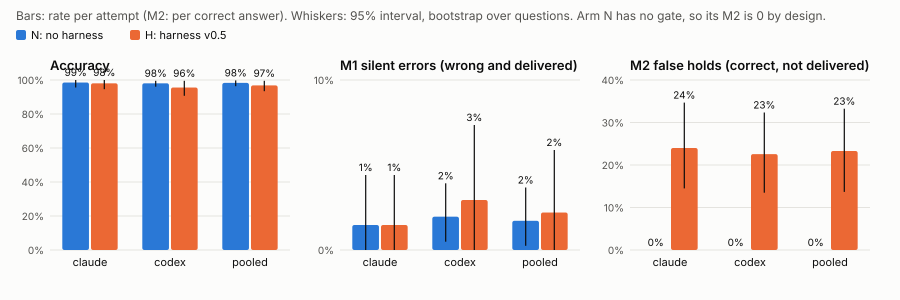
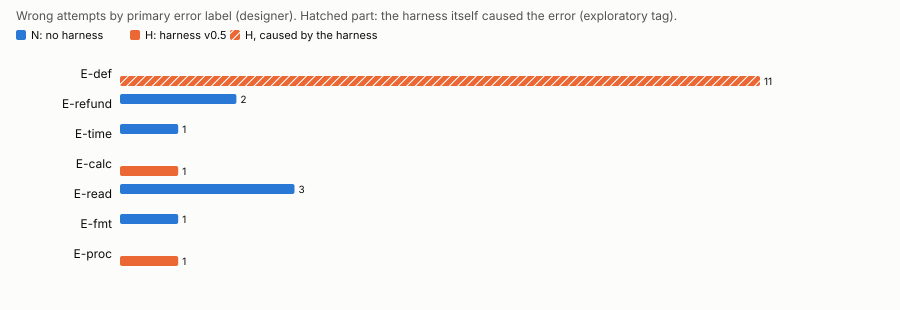
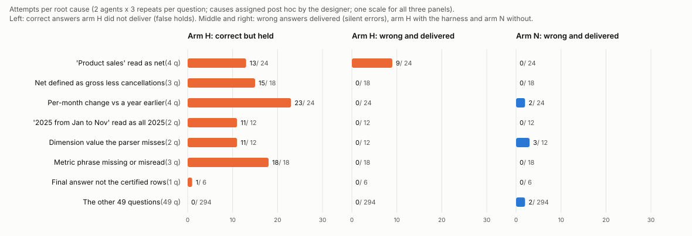

# E4 report: harness v0.5 on fresh retail questions

Pre-registered in [PREREGISTRATION.md](PREREGISTRATION.md) (final 2026-11-07 09:02); one later addition in
[DEVIATIONS.md](DEVIATIONS.md) (the sensitivity script, written before any result was read). Census 09:05–12:09
CST, 816 attempts, all OK. Analysis by the frozen `experiments/E1/analyze.py --rules e4`. Chinese version:
[REPORT.zh-CN.md](REPORT.zh-CN.md).

## Summary

E3a held 26.5% of arm H's correct answers on real retail data, mostly on four question shapes. Harness v0.5 added
those shapes. E4 asked, on 68 fresh questions of the same shapes written by models that saw neither the check code
nor the v0.5 list: does the gate now hold few enough right answers while still delivering fewer wrong ones?

**No.** None of the four decision rules is met in favour of the harness:

| rule | result | |
|---|---|---|
| R1: H delivers fewer wrong answers, and M2(H) ≤ 15% | not met | M1(H) 2.2% vs M1(N) 1.7%; paired difference [−2.7, +4.4] points; M2(H) 23.3% |
| R2: M2(H) > 15% (still too strict) | **met** | 23.3% [13.7, 33.2] (E3a: 26.5%, other bank) |
| R3: on DIRECT questions, H fewer wrong | not met | 2.9% vs 2.9% |
| R4: gate + second opinion as safe as two agents, holds no more, fewer runs | not met | M1 2.2% vs 0.0% (difference [0.0, +5.9]); M2 6.6% vs 2.2%; 1.18 runs per attempt |

The pre-registered sensitivity analyses give the same four decisions
([sensitivity.md](sensitivity.md): without the nested pairs, and without the two questions closest to E3a).

What the run shows:

1. **Both agents alone are almost always right on these questions.** Accuracy without the harness is 98.3% (Claude
   98.5%, Codex 98.0%). There is little left for a gate to catch. Arm N's 7 silent errors are misreadings and
   refund or time-window slips. One of them is a right value the grader cannot accept (months written as names).
2. **Every silent error of arm H was caused by the harness.** All 9 are on four questions that say "product sales".
   The gate read that generic word as net sales and held the agents' correct gross answers as "not the question
   asked". The agents then switched to net, which the gate certified, and delivered wrong answers. Arm N got the same
   questions right 24 times out of 24. The fault is at `src/dsharness/tools/analytics.py:497-499`: a default reading
   from a generic word is treated like an explicit one (F23, half built).
3. **The holds are still mostly the harness's gaps, not the agents' errors.** 92 correct answers were held. All of
   them are on 18 questions, with six causes, and five of the causes are harness or onboarding gaps (table below). On
   the other 49 questions, arm H delivered 293 of 294 attempts correctly and held no correct answer.
4. **The harness costs 3–5 times more per correct delivered answer.** Claude: $0.056 vs $0.018. Codex: 508k vs 93k
   tokens. Median time: 18.7 s vs 10.5 s for Claude, and 39.5 s vs 24.8 s for Codex.

On clean, governed retail data, a strong agent with a good data catalog does not need this gate for single analytics
answers, and the gate's term checks can make it worse. Where the harness should earn its place has to be shown on
other work: pipelines (E3d), data that changes under the agent, and process errors.

## Setup

- 68 questions (17 DIRECT, 50 DERIVED with one governed step, 1 DERIVED with none) on the UCI Online Retail II
  warehouse, written by Codex and Claude author runs that saw neither the check code nor the v0.5 list.
- Claude Code (Sonnet 5.5) and Codex (gpt-6-luna, high), 3 repetitions per question and arm: 408 attempts per arm.
- N: warehouse + catalog + Python. H: harness v0.5 analyst tools over the same warehouse, with the E4 semantic model.
- Grading and metrics as E3a: tolerance 0.05% or half a unit in the last reported place; cluster bootstrap over
  questions (2,000 resamples, seed 20261106), paired between arms.

## Pre-registered results

| | n | accuracy | M1 silent error | M2 false hold | abstention |
|---|---|---|---|---|---|
| Claude N | 204 | 98.5% | 1.5% [0.0, 4.4] | 0 | 0 |
| Claude H | 204 | 98.0% | 1.5% [0.0, 4.4] | 24.0% [14.5, 34.7] | — |
| Codex N | 204 | 98.0% | 2.0% [0.5, 3.9] | 0 | 0 |
| Codex H | 204 | 95.6% | 2.9% [0.0, 7.4] | 22.6% [13.5, 32.4] | — |
| **pooled N** | 408 | 98.3% | **1.7%** [0.2, 3.7] | 0 | 0 |
| **pooled H** | 408 | 96.8% | **2.2%** [0.0, 5.9] | **23.3%** [13.7, 33.2] | 22.5% |

- M3 (cost per correct delivered answer): Claude N $0.018, H $0.056; Codex N 93k tokens, H 508k tokens.
- M4 (pass^3, share of questions right on all three repetitions): pooled N 0.963, H 0.956.
- By form ([e4_by_form.svg](e4_by_form.svg)): DIRECT M1 2.9% in both arms, M2(H) 27.3%; DERIVED-step M1 N 1.3%, H 2.0%,
  M2(H) 20.9%. The single DERIVED-none question was held in every correct H attempt.
- Delivery rule: S2 (numbers equal) delivered 312 H attempts, byte-for-byte 305. The 7 extra are Codex's and are all
  correct.

## Error labels

The designer labelled all 20 wrong attempts (E1 guide), before reading Haiku's blind labels of a 30% sample.
Agreement with Haiku: 5 of 6, κ 0.727. The one disagreement is Claude N on F-H03: Haiku said E-def, the designer
E-read.

| arm | labels | harness-induced |
|---|---|---|
| H (13 wrong, 9 delivered) | E-def 11, E-calc 1, E-proc 1 | 11 (all 9 silent errors) |
| N (7 wrong, all delivered) | E-read 3, E-refund 2, E-time 1, E-fmt 1 | — |

One arm-N error is marked "grader?": codex F-L31 has the right values with the months written as names. Without it,
M1(N) is 1.5%.

## Why arm H held 92 correct answers (pre-registered secondary; causes post hoc)

The designer read the evidence behind every held correct attempt and gave each question one cause
([false_holds.md](false_holds.md), produced by `experiments/E4/false_holds.py`).

| root cause | questions | correct held | H silent errors | N silent errors | fix | where |
|---|---|---|---|---|---|---|
| "Product sales" read as net | 4 | 13 | 9 | 0 | a generic-only reading is satisfied by a declared metric that suppresses it | harness + onboarding |
| Net defined as "gross less cancellations" | 3 | 15 | 0 | 0 | a metric named inside the definition of another explains it, it does not replace it | harness + onboarding |
| Per-month change against a year earlier | 4 | 23 | 0 | 2 | a per-month change step with a base offset (12 or 1 months) | harness |
| "in 2025 from January to November" read as all of 2025 | 2 | 11 | 0 | 0 | parse "in YEAR from MONTH to MONTH" as one range | harness |
| Dimension value the parser misses (物料编码, an exclusion) | 2 | 11 | 0 | 3 | item codes after 物料编码 / item code; values in an exclusion clause are excluded | harness |
| Metric phrase missing or misread | 3 | 18 | 0 | 0 | term coverage test with these paraphrases | onboarding + harness |
| Final answer not the certified rows | 1 | 1 | 0 | 0 | none (agent) | agent |

- O3 estimated that 7% of fresh questions would resolve to another metric. Metric misreadings actually hit 10 of the
  68 questions (15%). They caused 46 of the 92 false holds and all 9 of arm H's silent errors.
- **A hold with a reason is an instruction.** In 9 attempts the gate's message ("the question asks about net…")
  moved the agent from a right answer to a wrong one. A term reading the gate is unsure of must ask a human. It must
  not invite the agent to re-answer.
- A reporting gap was found and fixed: `experiments/E1b/hold_reasons.py` did not read the contradiction the harness
  records, so 64 holds printed "no reason recorded". [hold_reasons.md](hold_reasons.md) now shows them (exploratory
  output; no decision quantity changes).

## Second opinion (R4)

- H + t2n (gate, then the other agent's arm-N answer when the certificate allows it) delivered 2.2% wrong and held
  6.6% of correct answers, at 1.18 runs per attempt.
- N + pair (two agents without the harness must agree) delivered 0.0% wrong and held 2.2%, at 2 runs per attempt.
- The second opinion cannot catch the 9 harness-induced errors, because they arrive VERIFIED and are delivered before
  a second opinion is asked.
- Agreement measured on raw rows against the grader's alias-normalised reading: [agreement_E4.md](agreement_E4.md)
  (exploratory).

## What changes next

1. **Do not tune v0.5 further on this bank.** The fixes above were found on E4's questions and would have to be tested
   on a fresh bank. More importantly, the agents alone are at 98% here. On this kind of task the ceiling for any gate
   is about 1.7 points of silent error, against 3–5 times the cost.
2. **Fix the harm first.** Make the generic-reading contradiction a question to a human, not a HOLD that steers the
   agent (F23). This is a correctness fix, independent of E4.
3. **Move the harness's evaluation to where errors are frequent or costly:**
   - pipelines and data that change (E3d: schema drift, control totals, the 2026-09 month that should be held);
   - modelling and experiment readouts (E3b and E3c, with the full toolchain);
   - long multi-step work, where a process error compounds.

## Limits

- One retail warehouse, two agents, one period. The questions are fresh but written by the same two model families
  as the agents.
- The root causes are the designer's post-hoc reading. Haiku checked only the error labels (6 of 20), not the causes.
- 68 questions give wide intervals. The paired M1 difference runs from −2.7 to +4.4 points.
- The data catalog given to arm N is good, written with the official definitions. With a poorer catalog, arm N would
  likely make more errors.
