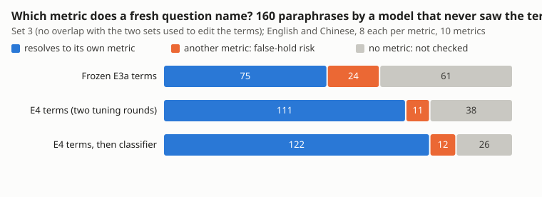

# O3 term coverage: do the model's terms reach the way people ask? (2026-11-07)

The harness reads which metric a question names through each metric's term lists (regexes). The check
matters both ways:
- **Another metric:** when a question resolves to the wrong metric, an agent's right declaration is
  "contradicted" and the answer is held (E3a: 17 false holds from term misreadings).
- **No metric:** when it resolves to none, a wrong declared metric is not caught at all.

O3 measures this before a model is frozen.

**Method** ([`experiments/E4/term_coverage.py`](../../../experiments/E4/term_coverage.py)). Haiku 5.5, with no
tools and no project files, gets each metric's label, unit and definition (never the terms). It writes 8 English
and 8 Chinese questions per metric that a manager or shop owner might type, including informal wording and typos.
Each question must resolve to its own metric. Three sets were drawn with the same prompt; no question repeats
across sets.

| set | used for |
|---|---|
| 1 `paraphrases_tune.json` | the first round of term edits |
| 2 `paraphrases_holdout.json` | measuring round 1, then the second round of edits (wrong-metric bugs only) |
| 3 `paraphrases_test.json` | the final measurement; never used for an edit |

## Result

| term lists, measured on | right | another metric (false-hold risk) | none (not checked) |
|---|---|---|---|
| frozen E3a model, set 1 | 75 / 160 (47%) | 27 | 58 |
| E4 draft (O1, O2, generic/qualifier split only), set 1 | 79 (49%) | 23 | 58 |
| E4 round 1, set 1 (its own tuning set) | 158 (99%) | 0 | 2 |
| E4 round 1, **set 2 (fresh)** | **114 (71%)** | 13 | 33 |
| frozen E3a model, set 3 | 75 (47%) | 24 | 61 |
| E4 round 2, **set 3 (fresh)** | **111 (69%)** | **11** | 38 |
| E4 round 2, then a classifier where the terms name nothing, set 3 | 122 (76%) | 12 | 26 |

Per metric and every miss: [E3a terms](term_coverage_E3a_test.md), [E4 terms](term_coverage_E4_test.md);
classifier: [probe](term_resolver_probe.md).

## What this says

1. **The E3a model's terms reached under half of plain questions.** That was frozen after about 2.5 designer
   hours. 15% of questions resolved to another metric (24 of 160), each a false hold waiting for a right answer.
   This matches E3a, where term misreadings caused 17 of the 114 false holds.
2. **Two rounds of term edits lift fresh-question coverage from 47% to about 70% and halve the wrong-metric
   readings (24 → 11 of 160).** The tuning set reaches 99%, the fresh sets 69–71%: regex lists fit the questions
   they were edited on and then plateau. Round 2 fixed real bugs (`\bunits?\b` matched "unit price"; 取消前,
   "before cancellations", read as cancelled value) but did not raise the fresh-set number.
3. **The paraphrases are also training data.** A character n-gram classifier trained only on set 1 (160
   questions plus the metric definitions) is precise: 1 wrong metric in 160 on set 3. It abstains on half
   the questions. As a fallback where the terms name nothing, it lifts coverage to 76% with one more
   wrong reading. With more paraphrases per metric, or a multilingual sentence encoder, recall should rise.
   This is a v0.6 candidate: generate paraphrases at onboarding, train the resolver, and use it only where
   the terms are silent.
4. **Onboarding quality is measurable before any agent runs.** The share of fresh questions resolving to
   another metric is an upper bound on the false holds the model can cause through term misreadings. It goes
   in every onboarding report beside the designer hours.

## Decision for E4

Freeze the E4 terms as they are after round 2 (69% / 11 wrong / 38 none on set 3), without the classifier.
E4 tests v0.5 as built, and adding a resolver is a separate change to test separately. E4 reports term
misreadings among its false holds so the estimate above can be checked against real agents. The paraphrase sets
are model-written synthetic questions with no personal data.
