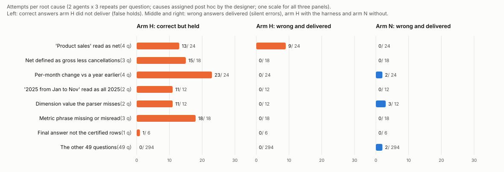

# E4 false holds by root cause (pre-registered secondary; causes post hoc, generated by false_holds.py)

Arm H held 92 correct answers (18 with a failed check, 74 inconclusive). All of them are on the 18 held questions below (F-L13, listed with its cause, has no hold but six wrong deliveries); on the other 49 questions arm H delivered 293 of 294 attempts correctly and held no correct answer. The questions below carry 9 of arm H's 9 silent errors and 5 of arm N's 7 (1 of arm N's are right values the registered grader cannot read, designer note `grader?`). Causes were assigned by the designer after reading the evidence (post hoc); fixes found here must be tested on a fresh bank.

| root cause | questions | H correct held (FAIL / INCONCL.) | H silent errors | N silent errors (of which grader?) | candidate fix | where |
|---|---|---|---|---|---|---|
| 'Product sales' read as net | 4 | 13 of 24 (1 / 12) | 9 | 0 of 24 (0) | a default (generic-only) reading is satisfied by a declared metric that suppresses it; gross term widened to 'before any cancellations' | harness + onboarding |
| Net defined as gross less cancellations | 3 | 15 of 18 (0 / 15) | 0 | 0 of 18 (0) | a metric named inside a definition of another explains it, it does not replace it; add 'less (the value of / its) cancellation(s)' to the net terms | harness + onboarding |
| Per-month change vs a year earlier | 4 | 23 of 24 (17 / 6) | 0 | 2 of 24 (1) | a per-month change step with a base offset (12 months for year on year, 1 for month on month), like cumsum | harness |
| '2025 from Jan to Nov' read as all 2025 | 2 | 11 of 12 (0 / 11) | 0 | 0 of 12 (0) | parse 'in YEAR from MONTH to MONTH' as one range; an explicit month range overrides a bare year in the fallback | harness |
| Dimension value the parser misses | 2 | 11 of 12 (0 / 11) | 0 | 3 of 12 (0) | read item codes after 物料编码 / 商品编码 / item code; values inside an exclusion clause ('left out', 'excluding', 不含) are excluded, not named | harness |
| Metric phrase missing or misread | 3 | 18 of 18 (0 / 18) | 0 | 0 of 18 (0) | term coverage test with these paraphrases; a dimension value phrase does not count as a metric mention | onboarding + harness |
| Final answer not the certified rows | 1 | 1 of 6 (0 / 1) | 0 | 0 of 6 (0) | none (agent) | agent |
| other questions | 49 | 0 of 294 | 0 | 2 of 294 (0) | | |

## Term misreadings against the O3 estimate

O3 estimated that 7% of fresh questions resolve to another metric, about 4.8 of these 68, or about 29 held attempts if every attempt on them were held. The metric misreadings found here ('Product sales' read as net, Net defined as gross less cancellations, Metric phrase missing or misread) cover 10 questions (15%). They account for 46 of the 92 false holds and 9 of arm H's 9 silent errors.

## Why hold_reasons.md shows 'answer.reconcile INCONCLUSIVE: (no reason recorded)'

Not a harness bug. When the declared metric_call reconciles but contradicts the question, analytics.submit_answer records the sentence in the certificate's `reasons` and in the reconcile evidence's `contradictions` list (src/dsharness/tools/analytics.py:871 computes them, 917-918 stores them, 966-970 writes the reason). experiments/E1b/hold_reasons.py:41-49 (`_why`) reads only `reason` and the key/value counts of the evidence, so every contradiction hold prints as 'no reason recorded'. The causes above come from the certificates' `reasons`.

## What went wrong, per cause

- **'Product sales' read as net** (F-H01, F-H04, F-H07, F-L13): the question says only 'product sales' (产品/商品销售额) or 'before any cancellations'; the generic-term default reads net sales, and claim_contradictions treats that default like an explicit reading, so a declared gross_product_sales (which suppresses net) is 'not the question asked' (src/dsharness/tools/analytics.py:497-499). H v0.5 F23 says a generic reading must not contradict a declared metric that suppresses it; only its qualifier half ('gross'/毛 just before the word) was built. The authors meant gross: arm N answered gross and was right. On F-H04 and F-L13 nine arm-H attempts switched from the right gross answer to net after the hold and were delivered wrong (VERIFIED). F-H01's 'before any cancellations' also misses the gross term, which expects 'before cancellations'. F-H07 is mixed: two holds on this reading (with an unread 只计算带客户编号的订单), one quarter ratio without a month column, one undeclared.
- **Net defined as gross less cancellations** (F-H23, F-H32, F-L09): the question names net product sales and then defines it ('meaning gross product sales less the value of cancellations', 即总产品销售额减去取消金额, 'use each quarter's gross product sales less its cancellation value'); both terms match, gross_product_sales suppresses net_product_sales, so the reading becomes gross and the correct net answer is held.
- **Per-month change vs a year earlier** (F-H10, F-H30, F-L12, F-L31): growth and difference steps compare one pair of months or collapse them; no step keeps one row per month with its year-ago base, so re-execution fails ('several rows for the single value') or the answer stays exploratory. Three Codex attempts certified each month as its own pair (difference a/b) and then answered all months at once, rows no certificate covers. E3a's R-H07 (change per month) asked for the same step.
- **'2025 from Jan to Nov' read as all 2025** (F-H18, F-H36): months_from_text finds the scope ambiguous; the fallback in claim_contradictions then takes every month the text names, and 'in 2025' names the whole year, so a declared January to November is held as narrower than asked (src/dsharness/tools/analytics.py:502-508). F26 covered '2025 through November' only.
- **Dimension value the parser misses** (F-H03, F-H25): F-H03: 物料编码 85123A names an item code, but no sku value or Chinese name for item code is recognised, so the declared sku filter counts as 'not named'; F-H25: 'Guest orders should be left out' names guests only to exclude them, and the parser counts both customer types as asked.
- **Metric phrase missing or misread** (F-L03, F-L26, F-L40): F-L03: 'identified customers' (a customer-type value) matches the active-customer term, which suppresses orders; F-L40: 'had at least one product line in an earlier month' defines repeat customers in words the repeat terms do not cover, so 'active customers' wins; F-L26: 售出多少件商品 is not a units term (the list has 卖出多少件 and 售出的数量), so only orders is asked.
- **Final answer not the certified rows** (F-L08): a VERIFIED submission, then the final answer restated the share at full precision (794 / 973), which no certificate covers (delivery rule S2).
