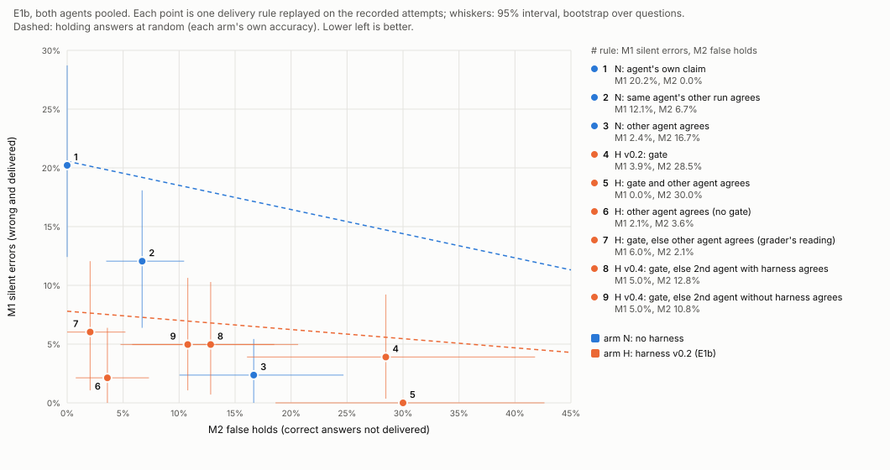

# H v0.4: a second opinion where no governed metric reaches (T2), then modelling tasks

Draft, 2026-11-07 03:45 (CST), written while the E3a census runs; updated 04:55 with the replay of the
built comparator (findings 6 and 7). v0.3 is frozen and serves E3a's arm H
from the live tree, so nothing here touches `src/` until E3a ends; v0.4 is built in a scratch copy, as
v0.3 was. Nothing here is pre-registered.

**Applied 2026-11-07 08:04**, after the E3a control run ended: `harness_v04.patch` (sha256 `d366bb1f…`) on the
v0.3 tree with `patch -p0`; the full suite passes (597 tests). Frozen state (the files the patch touches, and
the files v0.5 will touch, for a later diff):

| file | sha256 |
|---|---|
| `src/dsharness/tools/analytics.py` | `f9531b62ceb1d010c28ce0bf595c59fbfb2468406ce681f3261a00594b088cf9` |
| `src/dsharness/policies/gates.yaml` | `a52251bff6b0a32738958781ce8ea9ca023ff6a854a837c3780ff67154b19b5e` |
| `docs/answer_certificate.schema.json` | `8fd84bb82ef91011e96c9dab6368226827ee2514d4110c3ba1c8443ba4751181` |
| `tests/test_cross_check.py` | `3ff96099e94388d3dc127855b491b000ffca2111da2cb16a42c7e47003aa3e29` |
| `src/dsharness/context/semantic.py` | `0dcb7711d56addbc050902507c0b5d57cbaca2f58a2d3667b7b11cb569966850` |
| `src/dsharness/tools/derive.py` | `7f8550e09f0abaac8847ef63d9ed35ceb36f41c93ed5a3fa0ebb2c59aae5863c` |
| `src/dsharness/tools/shape.py` | `0f88315340b6d733bc4af6a0a598becead35af3d58a81e4d472ed59fddf69fec` |
| `src/dsharness/mcp_server.py` | `f8019729c9dd08f4625a3f9bac64a3a68f74103afed954ee719533448f64c672` |

## Why

E1b's verdict was D1 not met **only** because arm H held too many right answers (M2 28.5%), and 56 of
those 74 holds answered questions no governed metric covers. The gate cannot verify them by design,
so it holds them all. More metrics shrink that set but never empty it: real questions have a long tail.

The design already names the missing rung ([DESIGN.zh-CN.md](../DESIGN.zh-CN.md) §5.2): **T2,
cross-checked**: a non-certified question answered by two independent paths that agree (V3-D), plus
the V2 checks, good for internal decision support. `tools/analytics.py` reserves T2 and says it issues
it nowhere because it has no second path. v0.4 builds that path.

## Evidence: replaying agreement rules on E1 and E1b (exploratory)

Every census question was answered 3 times by Claude Code and 3 times by Codex in each arm, each in
its own sandbox and blind to the others. That gives independent second opinions for free:
[`experiments/H_v04/agreement_probe.py`](../../experiments/H_v04/agreement_probe.py) re-scores the recorded
attempts under other delivery rules, without running anything. Two answers agree when they have the
same keys and every value is within one grader tolerance of the other (0.05% of the larger value or
half a unit in the coarser one's last place; share ↔ percent only for rates). A blind review (Haiku)
found the first agreement test too lenient (either-direction grading, a ×100 scale change on money);
the test was tightened before the numbers below. Full tables:
[H_v0.4/agreement_E1_E1b.md](H_v0.4/agreement_E1_E1b.md).

E1b, both agents pooled, 282 attempts per arm (95% intervals from this replay, bootstrap over 47
questions, one random stream per cell; the E1b report's registered intervals differ in the last digit):

| arm and rule | accuracy | M1 silent errors | M2 false holds | random delivery at the same rate (M1 / M2) | extra agent runs |
|---|---|---|---|---|---|
| N: agent's own claim (recorded) | 79.4% | 20.2% [12.4, 28.7] | 0% | — | 0% |
| N: **deliver only if the other agent agrees** | 79.4% | **2.4%** [0.0, 5.4] | 16.7% [10.0, 24.7] | 14.1% / 31.4% | 100% |
| N: deliver if another run of the same agent agrees | 79.4% | 12.1% [6.4, 18.1] | 6.7% [3.5, 10.4] | 17.7% / 13.8% | 100% |
| H v0.2: gate (recorded) | 92.2% | 3.9% [0.4, 9.2] | 28.5% [16.1, 41.8] | — | 0% |
| H: gate, or else the other agent agrees | 92.2% | 6.0% [1.1, 12.1] | **2.1%** [0.0, 5.2] | 7.5% / 3.7% | 30% |
| H: v0.4 design, grader's reading: gate, or else the other agent agrees and the answer's own checks pass (T2d) | 92.2% | 6.0% [0.7, 12.8] | 6.9% [1.5, 14.1] | 7.2% / 8.2% | 25% |
| H: **v0.4 as built**, second agent with the harness: its raw rows pass `compare_answers`, both answers' own checks pass (t2x) | 92.2% | 5.0% [0.7, 10.3] | 12.8% [5.8, 20.6] | 6.7% / 14.7% | 25% |
| H: **v0.4 as built, second agent without the harness** (the other agent's arm-N attempt; t2n) | 92.2% | **5.0%** [1.1, 10.6] | **10.8%** [4.8, 18.5] | 6.8% / 12.8% | 25% |
| H: the other agent agrees (gate ignored) | 92.2% | 2.1% [0.0, 6.4] | 3.6% [0.8, 7.3] | 7.1% / 9.0% | 100% |
| H: gate and the other agent agrees | 92.2% | 0.0% | 30.0% [18.6, 42.6] | 5.0% / 35.5% | 100% |

What this says (exploratory; E1b's data also shaped v0.3):

1. **Two different agents agreeing is a strong check on its own.** Without any harness it cuts silent
   errors from 20.2% to 2.4% (E1: 21.5% to 0.5%), far better than holding the same share of answers
   at random. Any claim for the harness has to beat this baseline, which a buyer can build without us:
   E3a and every later test report it.
2. **The other agent must be a different model.** Without the harness, a second run of the same agent
   repeats its own mistakes (Codex's start-of-month boundary error recurs): 12.1%. With the harness the
   two are close (2.5% vs 2.1%): governed tools remove the idiosyncratic errors.
3. **Gate plus second opinion keeps the gate's accuracy and drops the holds**: M2 28.5% → 2.1% with a
   second agent run on 30% of the questions. Its M1 (6.0%) is 11 harness-induced errors of v0.2 that
   v0.3 fixes (F15, F16) plus one flawed question; the replay cannot apply v0.3 to E1b's transcripts.
4. **Where agreement fails: shared misreadings.** In arm H every wrong answer the two agents agreed on is
   C-H11, whose truth does not match its wording (every agent in every arm read it the same way). In
   arm N the rest are grader artefacts (0.58 for 0.5808 in both agents; Chinese plan names). A second
   opinion cannot catch a question everyone misreads; the gate cannot either.
5. **The conservative rule keeps most of the gain.** The v0.4 design lifts a held answer only when its
   own checks passed (static check, re-execution; reconciliation not FAIL): M2 6.9% with a second run
   on 25% of attempts. The difference to lifting everything (2.1%) is answers whose v0.2 reconciliation
   failed, mostly on the derive gaps v0.3 closed (running totals, one month minus another); E3a, run
   on v0.3, measures what is left. An answer the governed oracle contradicts stays held even when two
   agents agree: in E1 and E1b lifting those added no error, but that is the oracle's job, not the vote's.
6. **The built comparator is stricter than the grader's reading.** `compare_answers` sees the agents'
   raw columns, without the grader's key aliases or its share ↔ percent rule. On E1b it refuses 44
   pairs where the first answer states a column the second does not (mostly a constant `month`
   label), 23 where the second answer's own checks did not pass, and 12 where one agent wrote 39.1
   (percent) and the other 0.391 (share). M2 rises from 6.9% to 12.8%; M1 does not (5.0%). A first
   version set aside extra columns on both sides and so delivered labels only one agent had stated
   (`month: 2025` beside a yearly figure, graded wrong); now only the second answer's extra columns are
   set aside, so every value delivered under T2 was stated by both agents.
7. **A second agent with the same harness shares the harness's mistakes.** In E1 (harness v0.1) both
   agents made the same tool-induced errors on B-L16 and B-H06 and agree with each other: with t2x,
   silent errors rise from 24.8% to 29.6%. Taking the second opinion from the other agent's arm-N
   attempt (raw SQL, no harness tools) keeps them at 24.9% (M2 33.3% → 19.7%), and on E1b it is no
   worse than t2x (M1 5.0%, M2 10.8%). So v0.4 runs the second agent **without the governed tools**:
   another model on another path, which is what DESIGN §5.2 asks for ("two independent paths"). The
   second agent still submits its SQL through `submit_answer`, so its own static check and
   re-execution apply (arm N has no certificates, so the replay cannot apply them).

## Design (T2)

Built in a scratch copy and saved as [`experiments/H_v04/harness_v04.patch`](../../experiments/H_v04/harness_v04.patch)
(4 files; applies cleanly to the live tree; 24 new tests, the full suite of 597 passes). Not applied: E3a's arm H
serves v0.3 from the live tree until the census ends.

| id | change | where | status |
|---|---|---|---|
| T2a | `compare_answers(first_rows, second_rows)`: every column of the first (delivered) answer must be in the second, ignoring case; a column only the second has is set aside when it is a single-valued label or an extra value column (finding 6); a column is a key when a value is not a number or its name is a time or dimension name; rows pair by key; `values_close`: 0.05% of the larger value or half a unit in the coarser one's last place, at least 3 significant digits unless equal, **two whole numbers must be equal** (counts, ids). PASS / FAIL with the differing keys and values / INCONCLUSIVE (not comparable) | `tools/analytics.py` | built |
| T2b | `cross_check_answers(ctx, first, second)`: host-side; both answers are `submit_answer` certificates in the same workspace, rows re-digested against them, same question, same build, two principals, models of **two different providers** (E1b: a second run of the same agent repeats its mistakes). The host runs the second agent **without the governed tools** (SQL over the same build, then `submit_answer`; finding 7) | `tools/analytics.py`; the runner | built; runner after E3a |
| T2c | agreement → evidence `answer.cross_check` PASS on the first answer's subject (it includes the rows digest) → new gate stage `answer_internal` (static check + re-execution + cross-check) → ALLOW, trust label **T2**, "internal decision support". Disagreement → INCONCLUSIVE → HOLD with the differing values (either answer may be right; a person compares two worked answers) | `tools/analytics.py`, `policies/gates.yaml` | built |
| T2d | never lifted: an answer whose own static check or re-execution did not PASS, whose reconciliation FAILed or ERRORed (the governed oracle contradicts it), or that is FLAGGED; a VERIFIED answer needs no second opinion (error) | `second_opinion_problems` | built |
| T2e | certificate: producer `cross_check_answers`, `second_opinion` block (second certificate and principal, models and providers, outcome, evidence id, host principal); the schema allows T2 only with a passing `answer.cross_check`, gate `answer_internal` ALLOW, tier CONSISTENT; `answer_publish` is unchanged, so a T2 answer is never an official number | `answer_certificate.schema.json` | built |
| T2f | host side: run the second agent blind on a held question (`dsh second-opinion`); census: in arm H the second opinion for an attempt is the other agent's **arm-N** attempt at the same question (t2n), reported apart from VERIFIED, with the two-agent baseline for arm N | `cli.py`, `bench/census.py`, `experiments/E1/analyze.py` | after E3a |

Not an agent tool: `cross_check_answers` writes the registry, which agents cannot reach, and is in no role's
tool list (tested). As for every producer in this reference implementation, principals, models and providers
are the host's claims, and keeping the second agent blind is the host's job (production: workload
identities). A blind review (Haiku, code only) listed 17 points. Fixed (9): whole numbers compared with a
tolerance (an id 123456 matched 123457; counts 10000 and 9995 matched), model names as the only test of
independence (now two providers), principals compared case-sensitively, no explicit FLAGGED block, a
"cross-checked" reason printed when the gate did not allow, the first agent's principal overwritten, the
schema not requiring the cross-check evidence for T2, cross-check certificates accepted as input, column
names differing only in case. Documented (2): identities and blindness are the host's claims. Kept (6): an
answer the gate could not verify (reconcile INCONCLUSIVE) may be lifted even when a governed metric exists
for the question, since that is the case T2 is for; the metric tolerance never widened the 0.05% (governed
tolerances are 1e-9 and 1e-6), so that code was removed; the subject already binds the rows digest; trailing
zeros and a null on one side can only cause a HOLD, never a false T2.

Cost: one extra agent run per eligible held answer (E1b replay: 25% of attempts; the share falls as
coverage grows). Open: whether a host-side second opinion may see the first agent's SQL (cheaper, less
independent; the replay supports blind only), and how T2 decays when the data is rebuilt.

## How it gets tested

1. **E3a replay** (registered as exploratory in [E3a/DEVIATIONS.md](E3a/DEVIATIONS.md) before E3a results):
   the same rules on real data, where misreadings may be more common than in a designer-written world.
   **Result** ([agreement_E3a.md](H_v0.4/agreement_E3a.md), [E3a report](E3a/REPORT.md)): gate or else
   agreement (hybrid) M2 26.5% → 3.0%, M1 0, second run on 29% of questions; t2 12.8%, t2x 18.7%, t2n
   14.8% (M1 0.6%, all of it right top-5 lists keyed `item_code`, which the grader cannot read). The gap
   between hybrid and t2 is mostly **false FAILs**: 48 of the 114 held correct answers were FAILED,
   largely ratios declared as their numerator metric and growth recomputed from the first and last
   month, and T2d never lifts a FAIL. So the order is v0.5's coverage fixes (ratio of two metrics,
   period growth, per-month change, term and dimension gaps) before T2 can show its full effect.
2. If T2 holds up there: apply v0.4 after E3a, finish T2f, freeze, and pre-register **E4** on fresh blind
   questions in both worlds. Arms: N, N with two-agent agreement (no harness), H v0.4 (gate + T2).
   Decision rules on M1 and M2 against both baselines, with M3 counting the extra runs. The census
   still runs only arms N and H: the second opinion for a held arm-H attempt is the other agent's
   arm-N attempt at the same question (finding 7), and the two-agent baseline pairs the arm-N attempts
   with each other, so neither needs extra runs; their cost is counted from the attempts they reuse.

## Second track: modelling tasks (E3b)

The data-science tools are written for the synthetic churn task. E3b needs the workspace to declare
its task (T1–T5 in [E3b/DESIGN.md](E3b/DESIGN.md): `task.yaml` with population, label, window, maturity,
sealed date and budget; leakage check from the semantic model's event-time columns; out-of-time
training template; custody evaluator from the task file; a modelling grader in the census). This comes
after T2, because T2 decides how analytics answers are delivered, while E3b is a new test.
